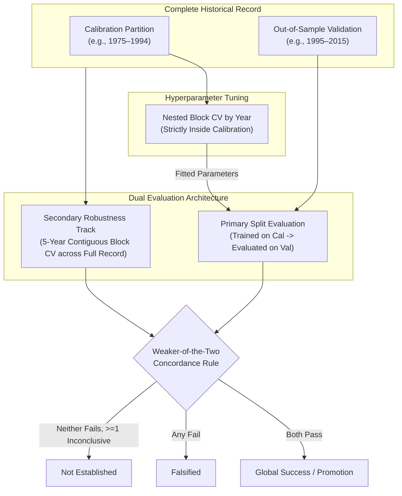

# Pre-Specified Evaluation Protocol for Statistical Downscaling & Orographic Bias Correction

**Protocol Version**: 1.0  
**Registration Date**: 2026-10-15  
**Framework**: `tropicor` (Tropical Correction and Orographic Resolution)  
**Baseline Commit**: `4cffe12`  
**Status**: Pre-Specified (Evaluation criteria and partitions established prior to daily method execution)  
**Target Variables**: Daily Precipitation Accumulation ($P$), Daily Maximum Temperature ($T_{\max}$), Daily Minimum Temperature ($T_{\min}$)  
**Target Reanalysis**: ECMWF ERA5 Hourly Reanalysis (single levels, 0.25° grid)  

---

## 1. Scope, Purpose & Pre-Specification Disclosures

### 1.1 Purpose
This document establishes the scientific falsification protocol, temporal partitioning, metric definitions, uncertainty quantification, operational aggregation, and parsimony progression rules for evaluating daily statistical downscaling and bias correction methods within `tropicor`. 

Statistical downscaling models are vulnerable to *over-fitting to calibration periods* and *post-hoc metric selection*, where model architectures, transfer functions, and filtering thresholds are iteratively tuned until summary statistics appear favorable. To enforce strict methodological discipline, this protocol freezes all evaluation rules, partitions, and thresholds before evaluating daily downscaling methods. If a proposed correction method fails the pre-specified out-of-sample criteria, that failure constitutes a definitive scientific finding and must be reported as such without post-hoc threshold adjustment.

### 1.2 Pre-Specification Status & Transparency Disclosures
In the interest of rigorous scientific transparency, the following baseline conditions are formally declared:

1. **Pre-Specified, Not Blind Criteria**:  
   The thresholds defined herein are **pre-specified**, not strictly blind. The author previously evaluated the raw ERA5 biases across the **complete available observation series** (including the precipitation validation years: 1975–2015 for Jardín Botánico and 1975–2000 for Aguas Claras, as well as the 1990–1994 temperature test records). Consequently, these criteria define the **minimum acceptable corrective performance** required for downscaled outputs to be credible in tropical complex terrain, informed by known raw model deficiencies.
2. **Prior Monthly Implementations vs. Daily Scope**:  
   Monthly downscaling models (`LinearScaling` and `EmpiricalQuantileMapping`) were previously implemented in Sprint 8 for monthly aggregated data. This protocol exclusively governs the implementation, training, and out-of-sample evaluation of **daily downscaling methods**.
3. **Validation Partition Integrity**:  
   As of commit `4cffe12` (the baseline of this protocol), **no daily downscaling method has been executed or evaluated on the out-of-sample validation partitions**.
4. **Amendment Requirement**:  
   Any subsequent alteration to partitions, metrics, or falsification thresholds must be recorded as a formal, versioned protocol amendment (e.g., Protocol v1.1) detailing the justification.

---

## 2. Benchmark Stations & Temporal Partitions

### 2.1 Benchmark Stations
The initial verification suite targets two contrasting physiographic and microclimatic benchmarks in Colombia. Metadata, audited coordinates, and elevations are drawn strictly from the audited station catalog (`StationCatalog` and `local/station_coords_audit.csv`):

1. **Jardín Botánico, Bogotá** (IDEAM ID `21205710`):
   - Department / Municipality: Cundinamarca / Bogotá
   - Audited Coordinates: 4.667867°N, -74.101034°W
   - Audited Surface Elevation: 2552.0 masl
   - Nearest ERA5 Grid Cell (Center): 4.75°N, -74.00°W ($z_{\text{era5}} = 2753.4\text{ m}$)
   - Elevation Difference: $\Delta z = z_{\text{station}} - z_{\text{model}} = -201.4\text{ m}$
2. **Aguas Claras, Cesar** (IDEAM ID `23215030`):
   - Department / Municipality: Cesar / Aguachica
   - Audited Coordinates: 8.228889°N, -73.602778°W
   - Audited Surface Elevation: 133.8 masl
   - Nearest ERA5 Grid Cell (Center): 8.25°N, -73.50°W ($z_{\text{era5}} = 762.4\text{ m}$)
   - Elevation Difference: $\Delta z = z_{\text{station}} - z_{\text{model}} = -628.6\text{ m}$
   - **Data Quality Limitation**: 100% of the temperature observations exported from IDEAM DHIME for Aguas Claras are flagged with approval level `Preliminar` (0% `Definitivo`). This limitation is logged as a source of observational uncertainty.

#### 2.1.1 Spatial Grid Cell Selection Rule
Downscaling extraction strictly uses the **geographically closest grid cell (center cell)**, permanently fixed. The surrounding $3 \times 3$ grid cells are evaluated purely as diagnostic sensitivity tools to inspect local orographic lapse rates. **Selecting a neighboring grid cell based on observed station bias or elevation minimization $|\Delta z|$ is strictly prohibited**, as doing so introduces post-hoc spatial selection bias. For reference, in the baseline 3×3 analysis (1990–1994, `local/reports/temperature_grid_3x3.csv`), the minimum-$|\Delta z|$ cell at Jardín Botánico (Δz = +2.9 m) showed a raw $T_{\max}$ bias of −3.18 °C versus −1.66 °C in the center cell, whereas at Aguas Claras the minimum-$|\Delta z|$ cell (Δz = −21.2 m) showed −2.67 °C versus −5.54 °C in the center cell. The effect of selecting by $|\Delta z|$ is therefore not consistent across stations.

### 2.2 Temporal Partitions
To ensure genuine out-of-sample validation, historical records are partitioned into non-overlapping calibration and validation periods. 

The temperature evaluation record begins in 1990 as a **scope decision of the download** (ERA5 itself is available since 1940; the project downloaded hourly 2m temperature starting in 1990), not because of any limit in ERA5 availability. 

For the temperature validation records (2005–2020 for Jardín Botánico and 2001–2011 for Aguas Claras), the author declares that the IDEAM observation files were only inventoried (date range, number of valid days, and Definitivo/Preliminar proportion) and that **no comparison, bias, correlation, or any other statistic against ERA5 has been computed for these years** (the ERA5 download is in progress; the files present have not been opened or compared). No downscaling method has processed them.

| Variable | Station | Total Record | Calibration Partition | Validation Partition | Evaluation Status |
| :--- | :--- | :---: | :---: | :---: | :---: |
| **Precipitation** ($P$) | Jardín Botánico (`21205710`) | 1975–2015 (41 yr) | **1975–1994** (20 yr) | **1995–2015** (21 yr) | Out-of-Sample Split |
| **Precipitation** ($P$) | Aguas Claras (`23215030`) | 1975–2000 (26 yr) | **1975–1987** (13 yr) | **1988–2000** (13 yr) | Out-of-Sample Split |
| **Temperature** ($T_{\max}, T_{\min}$) | Jardín Botánico (`21205710`) | 1990–2020 (31 yr) | **1990–2004** (15 yr) | **2005–2020** (16 yr) | Out-of-Sample Split (Unseen) |
| **Temperature** ($T_{\max}, T_{\min}$) | Aguas Claras (`23215030`) | 1990–2011 (22 yr) | **1990–2000** (11 yr) | **2001–2011** (11 yr) | Out-of-Sample Split (Unseen) |

### 2.3 Sensitivity to the 1979 Satellite Era Boundary
ECMWF ERA5 assimilates modern satellite radiance soundings starting in 1979. Prior to 1979, reanalyses rely primarily on surface observations and sparse radiosonde soundings. In regions of complex tropical topography, this fundamental change in data assimilation can potentially induce artificial trends or baseline shifts in humidity, temperature lapse rates, and convective precipitation.

- **Sensitivity Protocol**: Models will be recalibrated strictly on the post-satellite calibration record (1979–1994 for Jardín Botánico; 1979–1987 for Aguas Claras), excluding the pre-satellite period (1975–1978).
- **Evaluation**: The performance of the post-1979 calibrated model will be compared directly against the full-calibration model on the out-of-sample validation period. If excluding the pre-satellite era significantly improves validation metrics, the impact of assimilation changes on parameter stability will be documented.

### 2.4 Paired Missingness Mask
Ground station observations contain gaps resulting from sensor failures, maintenance, or missing reports. The `DhimeDailyPrecipitationAdapter` and `DhimeDailyTemperatureAdapter` assign a quality flag of `Faltante` or `np.nan` to these days.

- **Mandatory Masking Rule**: Any date where the station observation is missing (`np.nan` or `quality_flag == 'Faltante'`) **must be synchronously masked out** of the co-located ERA5 series prior to computing any metric.
- Unpaired evaluations are strictly prohibited to prevent uneven sample sizes from biasing frequency, percentile, or accumulation estimates.

### 2.5 Generalization Stations (Milestone v0.2.0)
To establish regional generalizability beyond the initial Andean benchmarks, candidate stations across additional natural regions of Colombia will be incorporated under milestone v0.2.0:
1. **Noanamá, Chocó** (Pacífico region).
2. **Arauca, Arauca** (Orinoquia region).
3. **Continental Caribbean Station** (Caribe region lowlands).

These stations will be integrated via formal protocol amendment (v1.1) and evaluated against the identical pre-specified criteria codified herein. **They are a separate milestone and do NOT count toward the operational designation of Section 5.4 for the two benchmark stations of v1.0.** Once added by amendment, operational designation is re-evaluated over the enlarged station set, and the v1.0 result is kept as a separate, unaltered record.

---

## 3. Metric Categorization: Decisive vs. Descriptive

Metrics are divided into **Decisive Metrics**, which govern method promotion, falsification, and progression; and **Descriptive Metrics**, which profile distribution properties without acting as falsification gates.

### 3.1 Sign Convention & Error Definitions
All comparisons adhere to a uniform definition where model bias is defined as:

$$\text{Bias} = \text{Model} - \text{Observed}$$

All error and percent bias comparisons adhere to a uniform sign convention where **positive values strictly denote improvement** (reduction in absolute error or bias):

$$\Delta \text{Error} = |\text{Error}_{\text{baseline}}| - |\text{Error}_{\text{candidate}}|$$

$$\Delta |PBIAS| = |PBIAS_{\text{baseline}}| - |PBIAS_{\text{candidate}}|$$

- $\Delta \text{Error} > 0$: Candidate method outperforms baseline (reduced error).
- $\Delta \text{Error} < 0$: Candidate method degrades performance (increased error).

### 3.2 Precipitation Decisive Metrics & Falsification Thresholds
Evaluated on out-of-sample validation series. A dry day is defined as $P < 1.0\text{ mm}$.

| Metric | Definition | Threshold / Tolerance | Rationale |
| :--- | :--- | :---: | :--- |
| **$f_{\text{wet}}$ (Total)** | Relative bias of total wet-day frequency ($P \ge 1.0\text{ mm}$): $100 \times \frac{f_{\text{mod}} - f_{\text{obs}}}{f_{\text{obs}}}$ | $\|PBIAS(f_{\text{wet}})\| \le 5\%$ | Resolves the ERA5 tropical drizzle inflation using a scale-independent relative bound. |
| **$f_{\text{wet, seasonal}}$** | Maximum seasonal relative bias for DEF, MAM, JJA, SON | $\max_{s} \|PBIAS(f_{\text{wet}, s})\| \le 10\%$ | Preserves the seasonal timing of wet/dry cycles across regimes. |
| **$P_{95}$ (Wet Days)** | Relative bias of the 95th empirical percentile of wet days ($P \ge 1.0\text{ mm}$) | $\|PBIAS(P_{95})\| \le 15\%$ | Evaluates convective heavy rainfall rates. |
| **$P_{99}$ (Wet Days)** | Relative bias of the 99th empirical percentile of wet days ($P \ge 1.0\text{ mm}$) | $\|PBIAS(P_{99})\| \le 25\%$ | Essential heavy-tail gate required to justify Level 3 (EQM) over Level 2. |
| **$CDD_{\max}$** | Annual maximum consecutive dry days ($P < 1.0\text{ mm}$) streak length | $\|PBIAS(CDD_{\max})\| \le 15\%$ | Critical for agricultural drought and hydrological low-flow modeling. |
| **$PBIAS_{\text{monthly}}$** | Percent bias of mean monthly accumulation: $100 \times \frac{\sum P_{\text{mod}} - \sum P_{\text{obs}}}{\sum P_{\text{obs}}}$ | $\|PBIAS\| \le 10\%$ | Ensures regional catchment water yield and conservation. |
| **Volume Outperformance** | Paired difference in absolute volume bias: $\Delta \|PBIAS\| = \|PBIAS_{\text{raw}}\| - \|PBIAS_{\text{corr}}\|$ | $\text{CI}_{95, \text{upper}}(\Delta \|PBIAS\|) \ge 0$ | Method must not significantly degrade total accumulation relative to raw ERA5. |

#### Completeness Rules for $CDD_{\max}$ Calculation
Missing observations can artificially truncate or generate spurious dry spells. To prevent artifacts, $CDD_{\max}$ calculation is subject to strict completeness rules:
1. **Annual Completeness**: A calendar year is evaluated only if it contains $\ge 330$ valid observation days.
2. **Monthly Completeness**: Any calendar month with $> 20\%$ missing days is excluded from streak propagation, and dry streaks crossing that month are marked invalid.

### 3.3 Precipitation Descriptive Metrics (Profiling Only)
Descriptive metrics are reported with 95% bootstrap confidence intervals for diagnostic characterization, without pass/fail thresholds:

1. **$Rx1\text{day}$** (Annual Maximum 1-day Precipitation):
   - Excluded from decisive falsification due to high single-event sampling variance over 13–21 year validation windows.
2. **$Rx5\text{day}$** (Annual Maximum Consecutive 5-day Accumulation):
   - Tracked as a diagnostic indicator of multi-day synoptic systems.
3. **$SDII$** (Simple Daily Intensity Index on wet days: $\sum P_{\text{wet}} / N_{\text{wet}}$):
   - **Mathematical Trade-Off Note**: In two-step threshold matching (Level 2), censoring sub-threshold amounts ($< P_{\text{th}}$) while scaling against total observed precipitation **tends to inflate $SDII$** on wet days ($\ge 1.0\text{ mm}$). This is a recognized mathematical property of trace truncation and is tracked descriptively rather than penalized as a model defect.

### 3.4 Temperature Decisive Metrics & Falsification Thresholds
Evaluated on out-of-sample validation series across $N_{\text{decisive}} = 3$ decisive metrics, subject to an absolute physical consistency disqualifying gate:

| Metric | Definition | Threshold / Tolerance | Rationale |
| :--- | :--- | :---: | :--- |
| **$|\text{Bias}_m|$** | Maximum absolute monthly bias across all calendar months ($m=1\dots12$): $\max\left(\max_m \|\text{Bias}_m(T_{\max})\|, \max_m \|\text{Bias}_m(T_{\min})\|\right)$ | $\le 0.5\,^\circ\text{C}$ | Prevents seasonal phase distortion in degree-day and phenological models. |
| **$DTR$ Bias** | Diurnal Temperature Range ($T_{\max} - T_{\min}$): absolute value of the mean DTR bias, $|\overline{DTR_{\text{mod}} - DTR_{\text{obs}}}|$ (not a daily MAE) | $\|\Delta DTR\| \le 0.8\,^\circ\text{C}$ | Captures boundary-layer thermal inertia and radiative damping. |
| **Extreme Percentiles** | Maximum extreme percentile bias: $\max\left(\|\Delta P_5(T_{\min})\|, \|\Delta P_{95}(T_{\max})\|\right)$ | $\le 0.8\,^\circ\text{C}$ | Evaluates thermal stress risks, frost exposure, and microclimatic extremes. |

#### Aggregation of Extreme Components
Pairwise extremes are aggregated taking the maximum absolute value. Both individual components (e.g., $P_5$ of $T_{\min}$ and $P_{95}$ of $T_{\max}$) and their respective 95% annual bootstrap confidence intervals must satisfy the $\le 0.8\,^\circ\text{C}$ threshold for the metric to achieve Pass.

#### Absolute Disqualifying Gate: Physical Consistency
- **Daily Ordering Constraint**: $T_{\min}(t) \le T_{\max}(t)$ on 100% of valid days.
- **Disqualification Rule**: Physical consistency is an absolute gate outside the $N_{\text{decisive}} = 3$ metric count. It is evaluated on the **final output** of each method, after the universal crossing rule of Section 3.5 has been applied. Any final day with $T_{\min}(t) > T_{\max}(t)$ results in **immediate fatal failure**.

### 3.5 Universal Crossing Rule (All Levels) & Crossing Diagnostics
A correction applied to $T_{\max}$ and $T_{\min}$ separately (Levels 1 and 3) may produce $T_{\min, \text{corr}}(t) > T_{\max, \text{corr}}(t)$. To avoid failing the gate on a technicality, the **same deterministic rule applies to every level (1, 2, and 3)**: if a crossing occurs, both values are set to $T_{\text{mid}} \pm 0.025\,^\circ\text{C}$, where $T_{\text{mid}}$ is the midpoint (formulas in Section 6.2).

- **Mandatory reporting**: for every method, station, and partition, report the number and the **fraction of days** on which the rule was triggered.
- **Distortion alert**: if the fraction exceeds **1%**, the scorecard must carry an explicit alert, because a method that collapses many days to $DTR = 0.05\,^\circ\text{C}$ is distorting the distribution even if it passes the gate. The alert does not change the Pass/Fail mapping but must be reported and discussed.
- **Note**: since the rule guarantees $DTR = 0.05\,^\circ\text{C} > 0$ on triggered days, the gate acts as an implementation check; the crossing fraction is the substantive diagnostic.

---

## 4. Cross-Validation Architecture & Concordance

Evaluation enforces strict architectural separation between hyperparameter selection, primary temporal validation, and decadal robustness testing.

### 4.1 Internal Hyperparameter Tuning (Nested Annual Block CV)
Any method with tunable parameters (such as the Level 3 EQM hyperparameter grids) must optimize those parameters **strictly via nested cross-validation inside the calibration partition**:
- **Partitioning**: Tuning must use **annual block cross-validation (splitting by whole calendar years)**, NOT random $K$-fold day-by-day resampling, to prevent synoptic autocorrelation from leaking across folds.
- **Selection Loss Function**: Hyperparameter combinations are chosen to minimize the multi-objective loss across validation folds within calibration:
  - *Temperature* (distributional loss): $\mathcal{L}_{\text{tuning}} = \sum_{V \in \{T_{\max}, T_{\min}, DTR\}} \frac{1}{19} \sum_{q \in \{5, 10, \dots, 95\}} \left| Q_q(V_{\text{mod}}) - Q_q(V_{\text{obs}}) \right|$, i.e., the mean absolute error between quantiles 5 to 95 (step 5). A daily MAE is deliberately **not** used because it rewards corrections that shrink variability and would bias the grid toward the least dispersive option, against the goal of preserving $DTR$ and the tails.
  - *Precipitation*: $\mathcal{L}_{\text{tuning}} = |PBIAS(f_{\text{wet}})| + |PBIAS(P_{95})| + |PBIAS(P_{99})|$
- Validation partition data must remain strictly unobserved during tuning.

### 4.2 Secondary Robustness Track: 5-Year Contiguous Block CV
In addition to the primary historical split, methods undergo a secondary robustness assessment using **5-year contiguous block cross-validation** across the entire record:
- The historical record is divided into contiguous 5-year blocks starting from the first year of the record (e.g., 1975–1979, 1980–1984, etc.). If fewer than 5 years remain at the end, they are merged into the final block (e.g., 41 years yield 8 blocks, with the final block spanning 6 years).
- In each fold, one 5-year block serves as the test set while the remaining blocks form the training set.
- Contiguous 5-year blocks preserve multi-year climate variability (e.g., El Niño / La Niña episodes) across folds.
- **Fixed hyperparameters**: the hyperparameters are those selected once in Section 4.1 (nested annual block CV inside the calibration partition) and remain **fixed**. In this track the cross-validation only refits the method's *parameters* (factors, thresholds, quantile maps) on each training set; it never re-tunes hyperparameters, so no information from validation-period data enters the selection.

### 4.3 Weaker-of-the-Two Concordance Rule
The overall rating is determined by the concordance between the Primary Split and the 5-Year Block CV:

$$\text{Global Outcome} = \min\left(\text{Outcome}_{\text{Primary Split}}, \text{Outcome}_{\text{5-Year Block CV}}\right)$$

Where ordinal ranks are: $\text{Fail} < \text{Inconclusive} < \text{Pass}$.
- A method achieves **Global Pass** if and only if both the Primary Split and the 5-Year Block CV achieve Pass status.
- If either track produces a Fail on any decisive metric, the global outcome is **Falsified**.
- If neither track produces a Fail but at least one is Inconclusive, the global outcome is **Not Established** (see Section 5.4).

---

## 5. Statistical Uncertainty & Three-Tier Outcome Mapping

Point estimates are evaluated alongside statistical uncertainty to differentiate true corrective skill from stochastic noise.

### 5.1 Annual Block Bootstrap Uncertainty
All metric biases and paired error differences are evaluated using a **1,000-replica block bootstrap with a fixed block length of 1 year (annual blocks)**:
- Resampling whole 1-year blocks preserves interannual climate variability (such as ENSO regimes) and prevents the artificial disruption or mixing of seasonal cycles.
- **Paired Bootstrap for Method Differences**: All paired error differences $\Delta \text{Error} = |\text{Error}_{k-1}| - |\text{Error}_k|$ and $\Delta |PBIAS| = |PBIAS_{\text{raw}}| - |PBIAS_{\text{corr}}|$ are computed via **paired annual block bootstrap**: in each of the 1,000 bootstrap iterations, the exact same resampled calendar years are evaluated for both candidate method and baseline.
- The 30-day block bootstrap is strictly reserved for daily lag analysis (temporal alignment).

### 5.2 Three-Tier Metric Outcomes
For every decisive metric $M$ with threshold $T$:
1. **Pass (Cumple)**:
   - The full 95% annual block bootstrap confidence interval lies entirely within the acceptable zone.
2. **Inconclusive (Inconcluso)**:
   - Any other case: the 95% confidence interval crosses the threshold boundary, **wherever the point estimate falls** (inside or outside the acceptable zone).
3. **Fail (Falla)**:
   - The full 95% confidence interval lies entirely outside the acceptable zone. A point estimate beyond the threshold with an interval that still includes acceptable values is **Inconclusive**, not Fail.

The rule is symmetric (it is the same logic used for $\Delta|PBIAS|$). Consequence: "Not Established" will be more frequent, and "Falsified" requires a violation with confidence.

### 5.3 Global State Mapping & 70% Rounding Rule
Across all $N_{\text{decisive}}$ decisive metrics evaluated:

- **Success / Promoted**:
  - Exactly **0** decisive metrics achieve **Fail**, AND
  - **Temperature only**: zero physical consistency violations ($T_{\min} \le T_{\max}$ on 100% of days); **precipitation only**: $P_{\text{corr}}(t) \ge 0$ and finite on every day, AND
  - **Precipitation only**: volume outperformance holds: $\text{CI}_{95, \text{upper}}(\Delta |PBIAS|) \ge 0$ (no statistically significant volume degradation relative to raw ERA5), AND
  - The number of **Pass** outcomes satisfies the 70% ceiling threshold:
    $$N_{\text{pass}} \ge \left\lceil 0.70 \times N_{\text{decisive}} \right\rceil$$
    - *Precipitation* ($N_{\text{decisive}} = 6$): $\lceil 0.70 \times 6 \rceil = \mathbf{5\text{ passes required}}$.
    - *Temperature* ($N_{\text{decisive}} = 3$): $\lceil 0.70 \times 3 \rceil = \mathbf{3\text{ passes required}}$ (all 3 must pass).
- **Not Established** (no Fail, insufficient evidence):
  - Exactly **0** decisive metrics achieve **Fail**, BUT $N_{\text{pass}} < \lceil 0.70 \times N_{\text{decisive}} \rceil$.
- **Falsified** (at least one Fail):
  - At least **1** decisive metric achieves **Fail**, OR
  - **Precipitation only**: $\text{CI}_{95, \text{upper}}(\Delta |PBIAS|) < 0$ (statistically significant degradation of volume bias relative to raw ERA5), OR
  - Temperature: any final day with $T_{\min} > T_{\max}$; precipitation: any day with $P_{\text{corr}} < 0$ or non-finite.

### 5.4 Operational Aggregation & Final Method Selection Rules
1. **Unit of Evaluation**: Every downscaling method is evaluated and scored independently **per station and per variable**.
2. **Operational Designation Rule**: A downscaling level $k$ is declared **operationally valid** for a given variable if and only if it achieves **Global Success across ALL benchmark stations**. If a level achieves success at one station but fails or is inconclusive at another, it cannot be designated as operational; station-specific performance and failure modes must be published transparently.
3. **Final Selection Rule**: For each variable, the final selected operational method is the **highest promoted level ($k$) that achieves Global Success across all benchmark stations**.
4. **Two distinct non-success outcomes** (to be reported and counted separately):
   - **Falsified**: at least one decisive metric obtained a Fail, i.e., its full 95% interval lies outside the acceptable zone (or a gate was violated). This refutes the method under this protocol, with confidence.
   - **Not Established**: no Fail, but at least one Inconclusive (e.g., confidence intervals too wide for 11–13 validation years). This reflects insufficient statistical power and **does not refute the method**.
   If no level achieves Global Success, the report states, per variable and station, which of the two outcomes occurred; "methodological falsification" is declared only if every non-successful level is Falsified. Otherwise the result is "not established", and Raw ERA5 remains uncorrected as the default meanwhile.

---

## 6. Formal Parsimony Progression & Downscaling Hierarchies

Methods are structured in strict hierarchies of increasing mathematical and parametric complexity.

### 6.1 Precipitation Downscaling Hierarchy
- **Level 0**: Raw ERA5 (Uncalibrated Baseline).
- **Level 1**: Linear Scaling (Monthly multiplicative factor: $P_{\text{corr}}(t) = s_m^{(1)} \cdot P_{\text{raw}}(t)$, with $s_m^{(1)} = \frac{\sum_{t \in \text{cal}, m(t)=m} P_{\text{obs}}(t)}{\sum_{t \in \text{cal}, m(t)=m} P_{\text{raw}}(t)}$).
- **Level 2**: Threshold Matching & Scaling (Empirical drizzle truncation + monthly scaling factor).
- **Level 3**: Non-Parametric Empirical Quantile Mapping (EQM). It **includes the drizzle truncation of Level 2** (same $P_{\text{th}, m}$ and $P_{\text{censored}}$ of Section 7), followed by EQM grouped according to the window option in Section 6.3 (calendar monthly or 31-day moving window) fitted on wet days only (observed days with $P \ge 1.0\text{ mm}$ versus censored model days with $P > 0$), using the hyperparameter grid of Section 6.3. Truncated days remain zero and no additional $s_m$ is applied (the quantile map defines the amounts).
  - **Known Trade-Off Note (Trace Volume & Negative PBIAS)**: Because Level 3 does not apply $s_m$, the volume of observed trace precipitation ($0.1\text{--}0.9\text{ mm}$) is not redistributed onto wet days. Consequently, $PBIAS_{\text{monthly}}$ can be slightly negative by design; this is reported and is evaluated solely against the pre-specified $|PBIAS_{\text{monthly}}| \le 10\%$ threshold.
- **Precipitation gate (all levels)**: $P_{\text{corr}}(t) \ge 0$ and finite on every day. Any violation is a fatal failure and sits outside the $N_{\text{decisive}}$ count.

### 6.2 Temperature Downscaling Hierarchy
The physical elevation adjustment ($-\Gamma \Delta z$) modifies both $T_{\max}$ and $T_{\min}$ equally, identically canceling in the diurnal temperature range:
$$(T_{\max} - \Gamma\Delta z) - (T_{\min} - \Gamma\Delta z) = T_{\max} - T_{\min}$$
Therefore, altitude adjustment is treated as an **optional preprocessing step**, not as an architectural tier. The temperature hierarchy is defined as:

- **Level 0**: Raw ERA5 (Uncalibrated Baseline).
- **Level 1 (Independent Monthly Bias)**:
  Applies independent monthly mean additive bias corrections for $T_{\max}$ and $T_{\min}$:
  $$T_{\max, \text{corr}}(t) = T_{\max, \text{mod}}(t) - \overline{\text{Bias}}_{m(t)}(T_{\max})$$
  $$T_{\min, \text{corr}}(t) = T_{\min, \text{mod}}(t) - \overline{\text{Bias}}_{m(t)}(T_{\min})$$
- **Level 2 (Mean State + DTR Scaling)**:
  Decomposes daily temperature into daily mean temperature ($T_{\text{mean}}$) and diurnal range ($DTR$):
  $$T_{\text{mean, mod}}(t) = \frac{T_{\max, \text{mod}}(t) + T_{\min, \text{mod}}(t)}{2}, \quad DTR_{\text{mod}}(t) = T_{\max, \text{mod}}(t) - T_{\min, \text{mod}}(t)$$
  Corrects $T_{\text{mean}}$ via monthly additive bias and scales $DTR$ via monthly multiplicative factor:
  $$T_{\text{mean, corr}}(t) = T_{\text{mean, mod}}(t) - \overline{\text{Bias}}_{m(t)}(T_{\text{mean}})$$
  $$DTR_{\text{corr}}(t) = s_{m(t)}^{DTR} \cdot DTR_{\text{mod}}(t), \quad \text{where } s_m^{DTR} = \frac{\overline{DTR}_{\text{obs}, m}}{\overline{DTR}_{\text{mod}, m}}$$
  Reconstructs daily extremes:
  $$T_{\max, \text{corr}}(t) = T_{\text{mean, corr}}(t) + \frac{DTR_{\text{corr}}(t)}{2}$$
  $$T_{\min, \text{corr}}(t) = T_{\text{mean, corr}}(t) - \frac{DTR_{\text{corr}}(t)}{2}$$
- **Level 3 (Monthly EQM with Deterministic Physical Reordering)**:
  Applies monthly non-parametric quantile mapping to $T_{\max}$ and $T_{\min}$ independently. As for every level (Section 3.5), if on any day $t$, $T_{\min, \text{corr}}(t) > T_{\max, \text{corr}}(t)$, the crossing is deterministically resolved by setting:
  $$T_{\text{mid}}(t) = \frac{T_{\max, \text{corr}}(t) + T_{\min, \text{corr}}(t)}{2}$$
  $$T_{\max, \text{final}}(t) = T_{\text{mid}}(t) + 0.025\,^\circ\text{C}$$
  $$T_{\min, \text{final}}(t) = T_{\text{mid}}(t) - 0.025\,^\circ\text{C}$$
  preserving daily mean temperature $T_{\text{mid}}$ while establishing $DTR = 0.05\,^\circ\text{C}$. This same rule is applied to Levels 1 and 2 whenever a crossing occurs. The count and fraction of triggered days ($N_{\text{crossings}}$) must be published per level, with the >1% alert of Section 3.5.

### 6.3 Level 3 Hyperparameter Grid (EQM)
Tuned strictly via nested annual block CV within the calibration partition:
1. **Window Definition**: Calendar monthly window vs. 31-day moving window centered on day of year ($t \pm 15$ days).
2. **Quantile Bins**: 50 bins vs. 100 bins (percentiles $1\dots99$).
3. **Extrapolation Scheme**: Constant extrapolation (clamping corrections outside calibration range) vs. linear extrapolation of extreme quantile ratios/deltas.

### 6.4 Progression Rule ($k-1 \to k$) & Known Multiplicity Limitation
A higher level ($k$) is promoted over a lower level ($k-1$) if and only if:
1. **Significant Improvement**: $\text{CI}_{95,\text{lower}}(\Delta \text{Error}) > 0$ for at least one metric in the **Primary Discriminating Family**:
   - *Precipitation (5 metrics)*: Total $f_{\text{wet}}$, Seasonal $f_{\text{wet}}$, Wet-day $P_{95}$, Wet-day $P_{99}$, $CDD_{\max}$.
   - *Temperature (3 metrics)*: $DTR$, $P_5$, $P_{95}$.
   - Total candidate comparisons across variables: **8 comparisons**.
2. **No Degradation**: No decisive metric has $\text{CI}_{95,\text{upper}}(\Delta \text{Error}) < 0$ (no statistically significant degradation).

> **Known Methodological Limitation (Multiplicity Risk)**:  
> Requiring improvement on "at least one" metric across a family of eight candidate decisive comparisons ($f_{\text{wet}}$ total, $f_{\text{wet}}$ seasonal, $P_{95}$, $P_{99}$, $CDD_{\max}$, $DTR$, $P_5$, $P_{95}$) retains a known non-zero risk of **false-positive promotion (Type I error)** due to multiple testing.  
> This standard is accepted in Phase 0 to avoid over-penalizing complex physical trade-offs in tropical terrain. However, it is formally documented as a limitation. In all scorecards, exact bootstrap intervals for all comparisons must be published simultaneously.

---

## 7. Mathematical Formulation of Level 2: Threshold Matching & Scaling

### 7.1 Wet-Day Frequency & Threshold Calculation
1. Observations define days with $P_{\text{obs}}(t) < P_0 = 1.0\text{ mm}$ as dry days.
2. For each calendar month $m \in \{1, \dots, 12\}$, let $f_{\text{obs}, m}^{\text{wet}}$ be the observed wet-day frequency during calibration:
   $$f_{\text{obs}, m}^{\text{wet}} = \frac{1}{N_{\text{obs}, m}} \sum_{t \in \text{cal}, m(t)=m} \mathbb{I}[P_{\text{obs}}(t) \ge P_0]$$
3. In the uncorrected ERA5 calibration series for month $m$, determine the empirical precipitation threshold $P_{\text{th}, m}$ such that the model wet-day frequency equals $f_{\text{obs}, m}^{\text{wet}}$:
   $$\Pr\left(P_{\text{ERA5}}(t) \ge P_{\text{th}, m} \mid m(t) = m, t \in \text{cal}\right) = f_{\text{obs}, m}^{\text{wet}}$$
   $P_{\text{th}, m}$ is computed directly as the $(1 - f_{\text{obs}, m}^{\text{wet}})$-th empirical quantile of the calibration ERA5 series for month $m$.

### 7.2 Trace Drizzle Censoring
All ERA5 amounts below $P_{\text{th}, m}$ are classified as drizzle and truncated to zero:

$$P_{\text{censored}}(t) = \begin{cases} P_{\text{ERA5}}(t), & \text{if } P_{\text{ERA5}}(t) \ge P_{\text{th}, m(t)} \\ 0.0, & \text{if } P_{\text{ERA5}}(t) < P_{\text{th}, m(t)} \end{cases}$$

### 7.3 Monthly Scaling Factor & Corrected Precipitation
To match the total observed water input, a monthly multiplicative scaling factor $s_m$ is calibrated:

$$s_m = \frac{\sum_{t \in \text{cal}, m(t)=m} P_{\text{obs}}(t)}{\sum_{t \in \text{cal}, m(t)=m} P_{\text{censored}}(t)}$$

The final corrected daily precipitation series for any day $t$ (calibration or validation) is:

$$P_{\text{corr}}(t) = s_{m(t)} \cdot P_{\text{censored}}(t)$$

### 7.4 Mass Conservation & SDII Trade-Off Notes
- **Mass Balance by Construction**: During calibration, $\sum_{t \in \text{cal}} P_{\text{corr}}(t) \equiv \sum_{t \in \text{cal}} P_{\text{obs}}(t)$ holds across each month $m$ **by construction**. It is an algebraic identity of the parameter fitting, **not** an emergent physical property or an out-of-sample validation achievement. Out-of-sample mass balance must be verified empirically on the validation partition.
- **SDII Inflation Tendency**: Because trace rainfall ($< 1.0\text{ mm}$) is removed from model dry days while $s_m$ preserves total observed accumulation, $s_m$ concentrates trace water volume onto the remaining wet days ($P \ge P_{\text{th}, m}$). Consequently, the mean wet-day intensity ($SDII$) **tends to be inflated** compared to observations:
  $$SDII(P_{\text{corr}}) > SDII(P_{\text{obs}})$$
  This inflation is a recognized, unavoidable structural trade-off of two-step threshold matching.
- **Level 3 Trace Volume Trade-Off**: Unlike Level 2, Level 3 does not apply $s_m$, so the volume of observed trace precipitation ($0.1\text{--}0.9\text{ mm}$) is not redistributed onto wet days. Consequently, $PBIAS_{\text{monthly}}$ may be slightly negative by design; this known trade-off is reported and only evaluated against the pre-specified $|PBIAS_{\text{monthly}}| \le 10\%$ threshold.

---

## 8. Observational Convention & Lag Audit for Temperature

When extended temperature records (2005–2020) are processed:

1. **Pre-Evaluation Sequencing**:
   The observational audit of extended temperature (2005–2020) **must be executed BEFORE any downscaling method is evaluated**.
2. **Strict Metric Boundary (No Validation Leakage)**:
   The audit must report **strictly lag correlations, cross-correlation curves, and extrema timing (NO bias, MAE, or error metrics)**, ensuring zero informational leakage regarding the validation set's mean state or variance.
3. **Protocol Amendment Gate**:
   A change is defined **only by the lag** (lag 0 versus ±1): if, in 2005–2020, the paired block-bootstrap difference between lag 0 and a lag of ±1 day has a 95% interval that excludes zero **in favor of a lag other than 0**, this protocol must be amended (**v1.1**) *before* any method evaluation. The difference between the 00–24 UTC and 05–05 UTC windows is **non-actionable** (in the 1990–1994 benchmark, the paired difference was small across all series: maximum $|\Delta r| \le 0.0057$ at lag 0 full year, $|\Delta r| \le 0.0112$ across seasonal subsets at lag 0, and $|\Delta r| \le 0.0181$ across all lags and seasons; furthermore, the direction of the difference is not consistent across stations and seasons, as documented in [`docs/guides/era5-extraction.md`](../guides/era5-extraction.md)) unless the paired difference exceeds a practical margin fixed now at $|\Delta r| > 0.05$ with a 95% interval that excludes zero; an apparent flip of the 'optimal' window within that margin does not trigger an amendment.
4. **Prohibition of Causal Speculation**:
   Reports must strictly record empirical correlation values and confidence intervals. Speculative explanations (such as undocumented changes in sensor shelter exposure or observer shifts) are prohibited without official IDEAM documentation.

---

## 9. Implementation Roadmap & Phase Linkage

- **Phase 0: Protocol Pre-Specification & Freezing** (Current):
  - Pre-specify criteria in `docs/science/evaluation-protocol.md`.
  - Validate documentation build (`mkdocs build --strict`).
  - Present for user review before committing or tagging (`protocol-v1`).
- **Phase 1: Verification Engine (`EvaluationSuite`)**:
  - Implement automated metric calculators with paired annual block bootstrap uncertainty.
  - Implement temporal splitters and 5-year contiguous block cross-validators.
  - Enforce paired missingness masking and $CDD_{\max}$ completeness rules.
- **Phase 2: Downscaling Hierarchy Implementation**:
  - Implement Level 1: Linear Scaling ($P$) & Independent Monthly Mean Bias ($T$).
  - Implement Level 2: Threshold Matching ($P$) & Mean State + DTR Scaling ($T$).
  - Implement Level 3: Monthly EQM ($P$) & Deterministic Physical Reordering EQM ($T$) with nested annual block CV.
- **Phase 3: Out-of-Sample Falsification & Reporting**:
  - Execute evaluation across benchmark partitions.
  - Generate Three-Tier Scorecards (Pass / Inconclusive / Fail).
  - Test parsimony progression ($k-1 \to k$) against the Primary Discriminating Family.
  - Publish final benchmark scorecard and falsification analyses.
