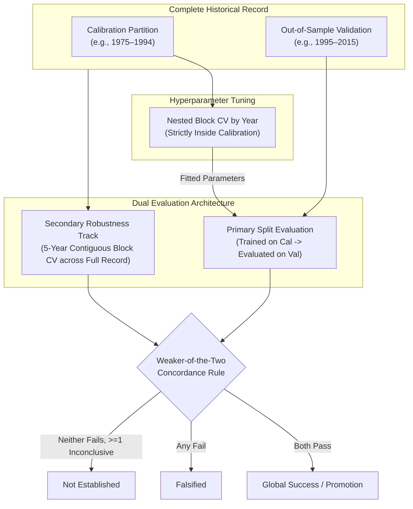

# Pre-Specified Evaluation Protocol for Statistical Downscaling & Orographic Bias Correction

**Protocol Version**: 1.0  
**Latest Amendment**: Protocol v1.6 (Appendix H: Andean Generalization Set Batch 1 Definition and Candidate Coverage Audit). Earlier: v1.5 (Appendix G), v1.4 (Appendix F), v1.3 (Appendix E), v1.2 (Appendix D), v1.1 (Appendix C)  
**Freeze Date (v1.6)**: 2026-10-23  
**Registration Date**: 2026-10-15  
**Framework**: `tropicor` (Tropical Correction and Orographic Resolution)  
**Baseline Commit**: `4cffe12`  
**Status**: Pre-Specified (Evaluation criteria and partitions established prior to daily method execution)  
**Target Variables**: Daily Precipitation Accumulation ($P$), Daily Maximum Temperature ($T_{\max}$), Daily Minimum Temperature ($T_{\min}$)  
**Target Reanalysis**: ECMWF ERA5 Hourly Reanalysis (single levels, 0.25° grid)  

---

## 1. Scope, Purpose & Pre-Specification Disclosures

### 1.1 Purpose
This document establishes the scientific falsification protocol, temporal partitioning, metric definitions, uncertainty quantification, operational aggregation, and parsimony progression rules for evaluating daily statistical downscaling and bias correction methods within `tropicor`. 

Statistical downscaling models are vulnerable to *over-fitting to calibration periods* and *post-hoc metric selection*, where model architectures, transfer functions, and filtering thresholds are iteratively tuned until summary statistics appear favorable. To enforce strict methodological discipline, this protocol freezes all evaluation rules, partitions, and thresholds before evaluating daily downscaling methods. If a proposed correction method fails the pre-specified out-of-sample criteria, that failure constitutes a definitive scientific finding and must be reported as such without post-hoc threshold adjustment.

### 1.2 Pre-Specification Status & Transparency Disclosures
In the interest of rigorous scientific transparency, the following baseline conditions are formally declared:

1. **Pre-Specified, Not Blind Criteria**:  
   The thresholds defined herein are **pre-specified**, not strictly blind. The author previously evaluated the raw ERA5 biases across the **complete available observation series** (including the precipitation validation years: 1975–2015 for Jardín Botánico and 1975–2000 for Aguas Claras, as well as the 1990–1994 temperature test records). Consequently, these criteria define the **minimum acceptable corrective performance** required for downscaled outputs to be credible in tropical complex terrain, informed by known raw model deficiencies.
2. **Prior Monthly Implementations vs. Daily Scope**:  
   Monthly downscaling models (`LinearScaling` and `EmpiricalQuantileMapping`) were previously implemented in Sprint 8 for monthly aggregated data. This protocol exclusively governs the implementation, training, and out-of-sample evaluation of **daily downscaling methods**.
3. **Validation Partition Integrity**:  
   As of commit `4cffe12` (the baseline of this protocol), **no daily downscaling method has been executed or evaluated on the out-of-sample validation partitions**.
4. **Amendment Requirement**:  
   Any subsequent alteration to partitions, metrics, or falsification thresholds must be recorded as a formal, versioned protocol amendment (e.g., Protocol v1.1) detailing the justification.

---

## 2. Benchmark Stations & Temporal Partitions

### 2.1 Benchmark Stations
The initial verification suite targets two contrasting physiographic and microclimatic benchmarks in Colombia. Metadata, audited coordinates, and elevations are drawn strictly from the audited station catalog (`StationCatalog` and `local/station_coords_audit.csv`):

1. **Jardín Botánico, Bogotá** (IDEAM ID `21205710`):
   - Department / Municipality: Cundinamarca / Bogotá
   - Audited Coordinates: 4.667867°N, -74.101034°W
   - Audited Surface Elevation: 2552.0 masl
   - Nearest ERA5 Grid Cell (Center): 4.75°N, -74.00°W ($z_{\text{era5}} = 2753.4\text{ m}$)
   - Elevation Difference: $\Delta z = z_{\text{station}} - z_{\text{model}} = -201.4\text{ m}$
2. **Aguas Claras, Cesar** (IDEAM ID `23215030`):
   - Department / Municipality: Cesar / Aguachica
   - Audited Coordinates: 8.228889°N, -73.602778°W
   - Audited Surface Elevation: 133.8 masl
   - Nearest ERA5 Grid Cell (Center): 8.25°N, -73.50°W ($z_{\text{era5}} = 762.4\text{ m}$)
   - Elevation Difference: $\Delta z = z_{\text{station}} - z_{\text{model}} = -628.6\text{ m}$
   - **Data Quality Limitation**: 100% of the temperature observations exported from IDEAM DHIME for Aguas Claras are flagged with approval level `Preliminar` (0% `Definitivo`). This limitation is logged as a source of observational uncertainty.

#### 2.1.1 Spatial Grid Cell Selection Rule
Downscaling extraction strictly uses the **geographically closest grid cell (center cell)**, permanently fixed. The surrounding $3 \times 3$ grid cells are evaluated purely as diagnostic sensitivity tools to inspect local orographic lapse rates. **Selecting a neighboring grid cell based on observed station bias or elevation minimization $|\Delta z|$ is strictly prohibited**, as doing so introduces post-hoc spatial selection bias. For reference, in the baseline 3×3 analysis (1990–1994, `local/reports/temperature_grid_3x3.csv`), the minimum-$|\Delta z|$ cell at Jardín Botánico (Δz = +2.9 m) showed a raw $T_{\max}$ bias of −3.18 °C versus −1.66 °C in the center cell, whereas at Aguas Claras the minimum-$|\Delta z|$ cell (Δz = −21.2 m) showed −2.67 °C versus −5.54 °C in the center cell. The effect of selecting by $|\Delta z|$ is therefore not consistent across stations.

### 2.2 Temporal Partitions
To ensure genuine out-of-sample validation, historical records are partitioned into non-overlapping calibration and validation periods. 

The temperature evaluation record begins in 1990 as a **scope decision of the download** (ERA5 itself is available since 1940; the project downloaded hourly 2m temperature starting in 1990), not because of any limit in ERA5 availability. 

For the temperature validation records (2005–2020 for Jardín Botánico and 2001–2011 for Aguas Claras), the author declares that the IDEAM observation files were only inventoried (date range, number of valid days, and Definitivo/Preliminar proportion) and that **no comparison, bias, correlation, or any other statistic against ERA5 has been computed for these years** (the ERA5 download is in progress; the files present have not been opened or compared). No downscaling method has processed them.

| Variable | Station | Total Record | Calibration Partition | Validation Partition | Evaluation Status |
| :--- | :--- | :---: | :---: | :---: | :---: |
| **Precipitation** ($P$) | Jardín Botánico (`21205710`) | 1975–2015 (41 yr) | **1975–1994** (20 yr) | **1995–2015** (21 yr) | Out-of-Sample Split |
| **Precipitation** ($P$) | Aguas Claras (`23215030`) | 1975–2000 (26 yr) | **1975–1987** (13 yr) | **1988–2000** (13 yr) | Out-of-Sample Split |
| **Temperature** ($T_{\max}, T_{\min}$) | Jardín Botánico (`21205710`) | 1990–2020 (31 yr) | **1990–2004** (15 yr) | **2005–2020** (16 yr) | Out-of-Sample Split (Unseen) |
| **Temperature** ($T_{\max}, T_{\min}$) | Aguas Claras (`23215030`) | 1990–2011 (22 yr) | **1990–2000** (11 yr) | **2001–2011** (11 yr) | Out-of-Sample Split (Unseen) |

### 2.3 Sensitivity to the 1979 Satellite Era Boundary
ECMWF ERA5 assimilates modern satellite radiance soundings starting in 1979. Prior to 1979, reanalyses rely primarily on surface observations and sparse radiosonde soundings. In regions of complex tropical topography, this fundamental change in data assimilation can potentially induce artificial trends or baseline shifts in humidity, temperature lapse rates, and convective precipitation.

- **Sensitivity Protocol**: Models will be recalibrated strictly on the post-satellite calibration record (1979–1994 for Jardín Botánico; 1979–1987 for Aguas Claras), excluding the pre-satellite period (1975–1978).
- **Evaluation**: The performance of the post-1979 calibrated model will be compared directly against the full-calibration model on the out-of-sample validation period. If excluding the pre-satellite era significantly improves validation metrics, the impact of assimilation changes on parameter stability will be documented.

### 2.4 Paired Missingness Mask
Ground station observations contain gaps resulting from sensor failures, maintenance, or missing reports. The `DhimeDailyPrecipitationAdapter` and `DhimeDailyTemperatureAdapter` assign a quality flag of `Faltante` or `np.nan` to these days.

- **Mandatory Masking Rule**: Any date where the station observation is missing (`np.nan` or `quality_flag == 'Faltante'`) **must be synchronously masked out** of the co-located ERA5 series prior to computing any metric.
- Unpaired evaluations are strictly prohibited to prevent uneven sample sizes from biasing frequency, percentile, or accumulation estimates.

### 2.5 Generalization Stations (Milestone v0.2.0)
To establish regional generalizability beyond the initial Andean benchmarks, candidate stations across additional natural regions of Colombia will be incorporated under milestone v0.2.0:
1. **Noanamá, Chocó** (Pacífico region).
2. **Arauca, Arauca** (Orinoquia region).
3. **Continental Caribbean Station** (Caribe region lowlands).

These stations will be integrated via formal protocol amendment (v1.1) and evaluated against the identical pre-specified criteria codified herein. **They are a separate milestone and do NOT count toward the operational designation of Section 5.4 for the two benchmark stations of v1.0.** Once added by amendment, operational designation is re-evaluated over the enlarged station set, and the v1.0 result is kept as a separate, unaltered record.

---

## 3. Metric Categorization: Decisive vs. Descriptive

Metrics are divided into **Decisive Metrics**, which govern method promotion, falsification, and progression; and **Descriptive Metrics**, which profile distribution properties without acting as falsification gates.

### 3.1 Sign Convention & Error Definitions
All comparisons adhere to a uniform definition where model bias is defined as:

$$\text{Bias} = \text{Model} - \text{Observed}$$

All error and percent bias comparisons adhere to a uniform sign convention where **positive values strictly denote improvement** (reduction in absolute error or bias):

$$\Delta \text{Error} = |\text{Error}_{\text{baseline}}| - |\text{Error}_{\text{candidate}}|$$

$$\Delta |PBIAS| = |PBIAS_{\text{baseline}}| - |PBIAS_{\text{candidate}}|$$

- $\Delta \text{Error} > 0$: Candidate method outperforms baseline (reduced error).
- $\Delta \text{Error} < 0$: Candidate method degrades performance (increased error).

### 3.2 Precipitation Decisive Metrics & Falsification Thresholds
Evaluated on out-of-sample validation series. A dry day is defined as $P < 1.0\text{ mm}$.

| Metric | Definition | Threshold / Tolerance | Rationale |
| :--- | :--- | :---: | :--- |
| **$f_{\text{wet}}$ (Total)** | Relative bias of total wet-day frequency ($P \ge 1.0\text{ mm}$): $100 \times \frac{f_{\text{mod}} - f_{\text{obs}}}{f_{\text{obs}}}$ | $\|PBIAS(f_{\text{wet}})\| \le 5\%$ | Resolves the ERA5 tropical drizzle inflation using a scale-independent relative bound. |
| **$f_{\text{wet, seasonal}}$** | Maximum seasonal relative bias for DEF, MAM, JJA, SON | $\max_{s} \|PBIAS(f_{\text{wet}, s})\| \le 10\%$ | Preserves the seasonal timing of wet/dry cycles across regimes. |
| **$P_{95}$ (Wet Days)** | Relative bias of the 95th empirical percentile of wet days ($P \ge 1.0\text{ mm}$) | $\|PBIAS(P_{95})\| \le 15\%$ | Evaluates convective heavy rainfall rates. |
| **$P_{99}$ (Wet Days)** | Relative bias of the 99th empirical percentile of wet days ($P \ge 1.0\text{ mm}$) | $\|PBIAS(P_{99})\| \le 25\%$ | Essential heavy-tail gate required to justify Level 3 (EQM) over Level 2. |
| **$CDD_{\max}$** | Annual maximum consecutive dry days ($P < 1.0\text{ mm}$) streak length | $\|PBIAS(CDD_{\max})\| \le 15\%$ | Critical for agricultural drought and hydrological low-flow modeling. |
| **$PBIAS_{\text{monthly}}$** | Percent bias of mean monthly accumulation: $100 \times \frac{\sum P_{\text{mod}} - \sum P_{\text{obs}}}{\sum P_{\text{obs}}}$ | $\|PBIAS\| \le 10\%$ | Ensures regional catchment water yield and conservation. |
| **Volume Outperformance** | Paired difference in absolute volume bias: $\Delta \|PBIAS\| = \|PBIAS_{\text{raw}}\| - \|PBIAS_{\text{corr}}\|$ | $\text{CI}_{95, \text{upper}}(\Delta \|PBIAS\|) \ge 0$ | Method must not significantly degrade total accumulation relative to raw ERA5. |

#### Completeness Rules for $CDD_{\max}$ Calculation
Missing observations can artificially truncate or generate spurious dry spells. To prevent artifacts, $CDD_{\max}$ calculation is subject to strict completeness rules:
1. **Annual Completeness**: A calendar year is evaluated only if it contains $\ge 330$ valid observation days.
2. **Monthly Completeness**: Any calendar month with $> 20\%$ missing days is excluded from streak propagation, and dry streaks crossing that month are marked invalid.

### 3.3 Precipitation Descriptive Metrics (Profiling Only)
Descriptive metrics are reported with 95% bootstrap confidence intervals for diagnostic characterization, without pass/fail thresholds:

1. **$Rx1\text{day}$** (Annual Maximum 1-day Precipitation):
   - Excluded from decisive falsification due to high single-event sampling variance over 13–21 year validation windows.
2. **$Rx5\text{day}$** (Annual Maximum Consecutive 5-day Accumulation):
   - Tracked as a diagnostic indicator of multi-day synoptic systems.
3. **$SDII$** (Simple Daily Intensity Index on wet days: $\sum P_{\text{wet}} / N_{\text{wet}}$):
   - **Mathematical Trade-Off Note**: In two-step threshold matching (Level 2), censoring sub-threshold amounts ($< P_{\text{th}}$) while scaling against total observed precipitation **tends to inflate $SDII$** on wet days ($\ge 1.0\text{ mm}$). This is a recognized mathematical property of trace truncation and is tracked descriptively rather than penalized as a model defect.

### 3.4 Temperature Decisive Metrics & Falsification Thresholds
Evaluated on out-of-sample validation series across $N_{\text{decisive}} = 3$ decisive metrics, subject to an absolute physical consistency disqualifying gate:

| Metric | Definition | Threshold / Tolerance | Rationale |
| :--- | :--- | :---: | :--- |
| **$|\text{Bias}_m|$** | Maximum absolute monthly bias across all calendar months ($m=1\dots12$): $\max\left(\max_m \|\text{Bias}_m(T_{\max})\|, \max_m \|\text{Bias}_m(T_{\min})\|\right)$ | $\le 0.5\,^\circ\text{C}$ | Prevents seasonal phase distortion in degree-day and phenological models. |
| **$DTR$ Bias** | Diurnal Temperature Range ($T_{\max} - T_{\min}$): absolute value of the mean DTR bias, $|\overline{DTR_{\text{mod}} - DTR_{\text{obs}}}|$ (not a daily MAE) | $\|\Delta DTR\| \le 0.8\,^\circ\text{C}$ | Captures boundary-layer thermal inertia and radiative damping. |
| **Extreme Percentiles** | Maximum extreme percentile bias: $\max\left(\|\Delta P_5(T_{\min})\|, \|\Delta P_{95}(T_{\max})\|\right)$ | $\le 0.8\,^\circ\text{C}$ | Evaluates thermal stress risks, frost exposure, and microclimatic extremes. |

#### Aggregation of Extreme Components
Pairwise extremes are aggregated taking the maximum absolute value. Both individual components (e.g., $P_5$ of $T_{\min}$ and $P_{95}$ of $T_{\max}$) and their respective 95% annual bootstrap confidence intervals must satisfy the $\le 0.8\,^\circ\text{C}$ threshold for the metric to achieve Pass.

#### Absolute Disqualifying Gate: Physical Consistency
- **Daily Ordering Constraint**: $T_{\min}(t) \le T_{\max}(t)$ on 100% of valid days.
- **Disqualification Rule**: Physical consistency is an absolute gate outside the $N_{\text{decisive}} = 3$ metric count. It is evaluated on the **final output** of each method, after the universal crossing rule of Section 3.5 has been applied. Any final day with $T_{\min}(t) > T_{\max}(t)$ results in **immediate fatal failure**.

### 3.5 Universal Crossing Rule (All Levels) & Crossing Diagnostics
A correction applied to $T_{\max}$ and $T_{\min}$ separately (Levels 1 and 3) may produce $T_{\min, \text{corr}}(t) > T_{\max, \text{corr}}(t)$. To avoid failing the gate on a technicality, the **same deterministic rule applies to every level (1, 2, and 3)**: if a crossing occurs, both values are set to $T_{\text{mid}} \pm 0.025\,^\circ\text{C}$, where $T_{\text{mid}}$ is the midpoint (formulas in Section 6.2).

- **Mandatory reporting**: for every method, station, and partition, report the number and the **fraction of days** on which the rule was triggered.
- **Distortion alert**: if the fraction exceeds **1%**, the scorecard must carry an explicit alert, because a method that collapses many days to $DTR = 0.05\,^\circ\text{C}$ is distorting the distribution even if it passes the gate. The alert does not change the Pass/Fail mapping but must be reported and discussed.
- **Note**: since the rule guarantees $DTR = 0.05\,^\circ\text{C} > 0$ on triggered days, the gate acts as an implementation check; the crossing fraction is the substantive diagnostic.

---

## 4. Cross-Validation Architecture & Concordance

Evaluation enforces strict architectural separation between hyperparameter selection, primary temporal validation, and decadal robustness testing.



### 4.1 Internal Hyperparameter Tuning (Nested Annual Block CV)
Any method with tunable parameters (such as the Level 3 EQM hyperparameter grids) must optimize those parameters **strictly via nested cross-validation inside the calibration partition**:
- **Partitioning**: Tuning must use **annual block cross-validation (splitting by whole calendar years)**, NOT random $K$-fold day-by-day resampling, to prevent synoptic autocorrelation from leaking across folds.
- **Selection Loss Function**: Hyperparameter combinations are chosen to minimize the multi-objective loss across validation folds within calibration:
  - *Temperature* (distributional loss): $\mathcal{L}_{\text{tuning}} = \sum_{V \in \{T_{\max}, T_{\min}, DTR\}} \frac{1}{19} \sum_{q \in \{5, 10, \dots, 95\}} \left| Q_q(V_{\text{mod}}) - Q_q(V_{\text{obs}}) \right|$, i.e., the mean absolute error between quantiles 5 to 95 (step 5). A daily MAE is deliberately **not** used because it rewards corrections that shrink variability and would bias the grid toward the least dispersive option, against the goal of preserving $DTR$ and the tails.
  - *Precipitation*: $\mathcal{L}_{\text{tuning}} = |PBIAS(f_{\text{wet}})| + |PBIAS(P_{95})| + |PBIAS(P_{99})|$
- Validation partition data must remain strictly unobserved during tuning.

### 4.2 Secondary Robustness Track: 5-Year Contiguous Block CV
In addition to the primary historical split, methods undergo a secondary robustness assessment using **5-year contiguous block cross-validation** across the entire record:
- The historical record is divided into contiguous 5-year blocks starting from the first year of the record (e.g., 1975–1979, 1980–1984, etc.). If fewer than 5 years remain at the end, they are merged into the final block (e.g., 41 years yield 8 blocks, with the final block spanning 6 years).
- In each fold, one 5-year block serves as the test set while the remaining blocks form the training set.
- Contiguous 5-year blocks preserve multi-year climate variability (e.g., El Niño / La Niña episodes) across folds.
- **Fixed hyperparameters**: the hyperparameters are those selected once in Section 4.1 (nested annual block CV inside the calibration partition) and remain **fixed**. In this track the cross-validation only refits the method's *parameters* (factors, thresholds, quantile maps) on each training set; it never re-tunes hyperparameters, so no information from validation-period data enters the selection.

### 4.3 Weaker-of-the-Two Concordance Rule
The overall rating is determined by the concordance between the Primary Split and the 5-Year Block CV:

$$\text{Global Outcome} = \min\left(\text{Outcome}_{\text{Primary Split}}, \text{Outcome}_{\text{5-Year Block CV}}\right)$$

Where ordinal ranks are: $\text{Fail} < \text{Inconclusive} < \text{Pass}$.
- A method achieves **Global Pass** if and only if both the Primary Split and the 5-Year Block CV achieve Pass status.
- If either track produces a Fail on any decisive metric, the global outcome is **Falsified**.
- If neither track produces a Fail but at least one is Inconclusive, the global outcome is **Not Established** (see Section 5.4).

---

## 5. Statistical Uncertainty & Three-Tier Outcome Mapping

Point estimates are evaluated alongside statistical uncertainty to differentiate true corrective skill from stochastic noise.

### 5.1 Annual Block Bootstrap Uncertainty
All metric biases and paired error differences are evaluated using a **1,000-replica block bootstrap with a fixed block length of 1 year (annual blocks)**:
- Resampling whole 1-year blocks preserves interannual climate variability (such as ENSO regimes) and prevents the artificial disruption or mixing of seasonal cycles.
- **Paired Bootstrap for Method Differences**: All paired error differences $\Delta \text{Error} = |\text{Error}_{k-1}| - |\text{Error}_k|$ and $\Delta |PBIAS| = |PBIAS_{\text{raw}}| - |PBIAS_{\text{corr}}|$ are computed via **paired annual block bootstrap**: in each of the 1,000 bootstrap iterations, the exact same resampled calendar years are evaluated for both candidate method and baseline.
- The 30-day block bootstrap is strictly reserved for daily lag analysis (temporal alignment).

### 5.2 Three-Tier Metric Outcomes
For every decisive metric $M$ with threshold $T$:
1. **Pass (Cumple)**:
   - The full 95% annual block bootstrap confidence interval lies entirely within the acceptable zone.
2. **Inconclusive (Inconcluso)**:
   - Any other case: the 95% confidence interval crosses the threshold boundary, **wherever the point estimate falls** (inside or outside the acceptable zone).
3. **Fail (Falla)**:
   - The full 95% confidence interval lies entirely outside the acceptable zone. A point estimate beyond the threshold with an interval that still includes acceptable values is **Inconclusive**, not Fail.

The rule is symmetric (it is the same logic used for $\Delta|PBIAS|$). Consequence: "Not Established" will be more frequent, and "Falsified" requires a violation with confidence.

### 5.3 Global State Mapping & 70% Rounding Rule
Across all $N_{\text{decisive}}$ decisive metrics evaluated:

- **Success / Promoted**:
  - Exactly **0** decisive metrics achieve **Fail**, AND
  - **Temperature only**: zero physical consistency violations ($T_{\min} \le T_{\max}$ on 100% of days); **precipitation only**: $P_{\text{corr}}(t) \ge 0$ and finite on every day, AND
  - **Precipitation only**: volume outperformance holds: $\text{CI}_{95, \text{upper}}(\Delta |PBIAS|) \ge 0$ (no statistically significant volume degradation relative to raw ERA5), AND
  - The number of **Pass** outcomes satisfies the 70% ceiling threshold:
    $$N_{\text{pass}} \ge \left\lceil 0.70 \times N_{\text{decisive}} \right\rceil$$
    - *Precipitation* ($N_{\text{decisive}} = 6$): $\lceil 0.70 \times 6 \rceil = \mathbf{5\text{ passes required}}$.
    - *Temperature* ($N_{\text{decisive}} = 3$): $\lceil 0.70 \times 3 \rceil = \mathbf{3\text{ passes required}}$ (all 3 must pass).
- **Not Established** (no Fail, insufficient evidence):
  - Exactly **0** decisive metrics achieve **Fail**, BUT $N_{\text{pass}} < \lceil 0.70 \times N_{\text{decisive}} \rceil$.
- **Falsified** (at least one Fail):
  - At least **1** decisive metric achieves **Fail**, OR
  - **Precipitation only**: $\text{CI}_{95, \text{upper}}(\Delta |PBIAS|) < 0$ (statistically significant degradation of volume bias relative to raw ERA5), OR
  - Temperature: any final day with $T_{\min} > T_{\max}$; precipitation: any day with $P_{\text{corr}} < 0$ or non-finite.

### 5.4 Operational Aggregation & Final Method Selection Rules
1. **Unit of Evaluation**: Every downscaling method is evaluated and scored independently **per station and per variable**.
2. **Operational Designation Rule**: A downscaling level $k$ is declared **operationally valid** for a given variable if and only if it achieves **Global Success across ALL benchmark stations**. If a level achieves success at one station but fails or is inconclusive at another, it cannot be designated as operational; station-specific performance and failure modes must be published transparently.
3. **Final Selection Rule**: For each variable, the final selected operational method is the **highest promoted level ($k$) that achieves Global Success across all benchmark stations**.
4. **Two distinct non-success outcomes** (to be reported and counted separately):
   - **Falsified**: at least one decisive metric obtained a Fail, i.e., its full 95% interval lies outside the acceptable zone (or a gate was violated). This refutes the method under this protocol, with confidence.
   - **Not Established**: no Fail, but at least one Inconclusive (e.g., confidence intervals too wide for 11–13 validation years). This reflects insufficient statistical power and **does not refute the method**.
   If no level achieves Global Success, the report states, per variable and station, which of the two outcomes occurred; "methodological falsification" is declared only if every non-successful level is Falsified. Otherwise the result is "not established", and Raw ERA5 remains uncorrected as the default meanwhile.

---

## 6. Formal Parsimony Progression & Downscaling Hierarchies

Methods are structured in strict hierarchies of increasing mathematical and parametric complexity.

### 6.1 Precipitation Downscaling Hierarchy
- **Level 0**: Raw ERA5 (Uncalibrated Baseline).
- **Level 1**: Linear Scaling (Monthly multiplicative factor: $P_{\text{corr}}(t) = s_m^{(1)} \cdot P_{\text{raw}}(t)$, with $s_m^{(1)} = \frac{\sum_{t \in \text{cal}, m(t)=m} P_{\text{obs}}(t)}{\sum_{t \in \text{cal}, m(t)=m} P_{\text{raw}}(t)}$).
- **Level 2**: Threshold Matching & Scaling (Empirical drizzle truncation + monthly scaling factor).
- **Level 3**: Non-Parametric Empirical Quantile Mapping (EQM). It **includes the drizzle truncation of Level 2** (same $P_{\text{th}, m}$ and $P_{\text{censored}}$ of Section 7), followed by EQM grouped according to the window option in Section 6.3 (calendar monthly or 31-day moving window) fitted on wet days only (observed days with $P \ge 1.0\text{ mm}$ versus censored model days with $P > 0$), using the hyperparameter grid of Section 6.3. Truncated days remain zero and no additional $s_m$ is applied (the quantile map defines the amounts).
  - **Known Trade-Off Note (Trace Volume & Negative PBIAS)**: Because Level 3 does not apply $s_m$, the volume of observed trace precipitation ($0.1\text{--}0.9\text{ mm}$) is not redistributed onto wet days. Consequently, $PBIAS_{\text{monthly}}$ can be slightly negative by design; this is reported and is evaluated solely against the pre-specified $|PBIAS_{\text{monthly}}| \le 10\%$ threshold.
- **Precipitation gate (all levels)**: $P_{\text{corr}}(t) \ge 0$ and finite on every day. Any violation is a fatal failure and sits outside the $N_{\text{decisive}}$ count.

### 6.2 Temperature Downscaling Hierarchy
The physical elevation adjustment ($-\Gamma \Delta z$) modifies both $T_{\max}$ and $T_{\min}$ equally, identically canceling in the diurnal temperature range:
$$(T_{\max} - \Gamma\Delta z) - (T_{\min} - \Gamma\Delta z) = T_{\max} - T_{\min}$$
Therefore, altitude adjustment is treated as an **optional preprocessing step**, not as an architectural tier. The temperature hierarchy is defined as:

- **Level 0**: Raw ERA5 (Uncalibrated Baseline).
- **Level 1 (Independent Monthly Bias)**:
  Applies independent monthly mean additive bias corrections for $T_{\max}$ and $T_{\min}$:
  $$T_{\max, \text{corr}}(t) = T_{\max, \text{mod}}(t) - \overline{\text{Bias}}_{m(t)}(T_{\max})$$
  $$T_{\min, \text{corr}}(t) = T_{\min, \text{mod}}(t) - \overline{\text{Bias}}_{m(t)}(T_{\min})$$
- **Level 2 (Mean State + DTR Scaling)**:
  Decomposes daily temperature into daily mean temperature ($T_{\text{mean}}$) and diurnal range ($DTR$):
  $$T_{\text{mean, mod}}(t) = \frac{T_{\max, \text{mod}}(t) + T_{\min, \text{mod}}(t)}{2}, \quad DTR_{\text{mod}}(t) = T_{\max, \text{mod}}(t) - T_{\min, \text{mod}}(t)$$
  Corrects $T_{\text{mean}}$ via monthly additive bias and scales $DTR$ via monthly multiplicative factor:
  $$T_{\text{mean, corr}}(t) = T_{\text{mean, mod}}(t) - \overline{\text{Bias}}_{m(t)}(T_{\text{mean}})$$
  $$DTR_{\text{corr}}(t) = s_{m(t)}^{DTR} \cdot DTR_{\text{mod}}(t), \quad \text{where } s_m^{DTR} = \frac{\overline{DTR}_{\text{obs}, m}}{\overline{DTR}_{\text{mod}, m}}$$
  Reconstructs daily extremes:
  $$T_{\max, \text{corr}}(t) = T_{\text{mean, corr}}(t) + \frac{DTR_{\text{corr}}(t)}{2}$$
  $$T_{\min, \text{corr}}(t) = T_{\text{mean, corr}}(t) - \frac{DTR_{\text{corr}}(t)}{2}$$
- **Level 3 (Monthly EQM with Deterministic Physical Reordering)**:
  Applies monthly non-parametric quantile mapping to $T_{\max}$ and $T_{\min}$ independently. As for every level (Section 3.5), if on any day $t$, $T_{\min, \text{corr}}(t) > T_{\max, \text{corr}}(t)$, the crossing is deterministically resolved by setting:
  $$T_{\text{mid}}(t) = \frac{T_{\max, \text{corr}}(t) + T_{\min, \text{corr}}(t)}{2}$$
  $$T_{\max, \text{final}}(t) = T_{\text{mid}}(t) + 0.025\,^\circ\text{C}$$
  $$T_{\min, \text{final}}(t) = T_{\text{mid}}(t) - 0.025\,^\circ\text{C}$$
  preserving daily mean temperature $T_{\text{mid}}$ while establishing $DTR = 0.05\,^\circ\text{C}$. This same rule is applied to Levels 1 and 2 whenever a crossing occurs. The count and fraction of triggered days ($N_{\text{crossings}}$) must be published per level, with the >1% alert of Section 3.5.

### 6.3 Level 3 Hyperparameter Grid (EQM)
Tuned strictly via nested annual block CV within the calibration partition:
1. **Window Definition**: Calendar monthly window vs. 31-day moving window centered on day of year ($t \pm 15$ days).
2. **Quantile Bins**: 50 bins vs. 100 bins (percentiles $1\dots99$).
3. **Extrapolation Scheme**: Constant extrapolation (clamping corrections outside calibration range) vs. linear extrapolation of extreme quantile ratios/deltas.

### 6.4 Progression Rule ($k-1 \to k$) & Known Multiplicity Limitation
A higher level ($k$) is promoted over a lower level ($k-1$) if and only if:
1. **Significant Improvement**: $\text{CI}_{95,\text{lower}}(\Delta \text{Error}) > 0$ for at least one metric in the **Primary Discriminating Family**:
   - *Precipitation (5 metrics)*: Total $f_{\text{wet}}$, Seasonal $f_{\text{wet}}$, Wet-day $P_{95}$, Wet-day $P_{99}$, $CDD_{\max}$.
   - *Temperature (3 metrics)*: $DTR$, $P_5$, $P_{95}$.
   - Total candidate comparisons across variables: **8 comparisons**.
2. **No Degradation**: No decisive metric has $\text{CI}_{95,\text{upper}}(\Delta \text{Error}) < 0$ (no statistically significant degradation).

> **Known Methodological Limitation (Multiplicity Risk)**:  
> Requiring improvement on "at least one" metric across a family of eight candidate decisive comparisons ($f_{\text{wet}}$ total, $f_{\text{wet}}$ seasonal, $P_{95}$, $P_{99}$, $CDD_{\max}$, $DTR$, $P_5$, $P_{95}$) retains a known non-zero risk of **false-positive promotion (Type I error)** due to multiple testing.  
> This standard is accepted in Phase 0 to avoid over-penalizing complex physical trade-offs in tropical terrain. However, it is formally documented as a limitation. In all scorecards, exact bootstrap intervals for all comparisons must be published simultaneously.

---

## 7. Mathematical Formulation of Level 2: Threshold Matching & Scaling

### 7.1 Wet-Day Frequency & Threshold Calculation
1. Observations define days with $P_{\text{obs}}(t) < P_0 = 1.0\text{ mm}$ as dry days.
2. For each calendar month $m \in \{1, \dots, 12\}$, let $f_{\text{obs}, m}^{\text{wet}}$ be the observed wet-day frequency during calibration:
   $$f_{\text{obs}, m}^{\text{wet}} = \frac{1}{N_{\text{obs}, m}} \sum_{t \in \text{cal}, m(t)=m} \mathbb{I}[P_{\text{obs}}(t) \ge P_0]$$
3. In the uncorrected ERA5 calibration series for month $m$, determine the empirical precipitation threshold $P_{\text{th}, m}$ such that the model wet-day frequency equals $f_{\text{obs}, m}^{\text{wet}}$:
   $$\Pr\left(P_{\text{ERA5}}(t) \ge P_{\text{th}, m} \mid m(t) = m, t \in \text{cal}\right) = f_{\text{obs}, m}^{\text{wet}}$$
   $P_{\text{th}, m}$ is computed directly as the $(1 - f_{\text{obs}, m}^{\text{wet}})$-th empirical quantile of the calibration ERA5 series for month $m$.

### 7.2 Trace Drizzle Censoring
All ERA5 amounts below $P_{\text{th}, m}$ are classified as drizzle and truncated to zero:

$$P_{\text{censored}}(t) = \begin{cases} P_{\text{ERA5}}(t), & \text{if } P_{\text{ERA5}}(t) \ge P_{\text{th}, m(t)} \\ 0.0, & \text{if } P_{\text{ERA5}}(t) < P_{\text{th}, m(t)} \end{cases}$$

### 7.3 Monthly Scaling Factor & Corrected Precipitation
To match the total observed water input, a monthly multiplicative scaling factor $s_m$ is calibrated:

$$s_m = \frac{\sum_{t \in \text{cal}, m(t)=m} P_{\text{obs}}(t)}{\sum_{t \in \text{cal}, m(t)=m} P_{\text{censored}}(t)}$$

The final corrected daily precipitation series for any day $t$ (calibration or validation) is:

$$P_{\text{corr}}(t) = s_{m(t)} \cdot P_{\text{censored}}(t)$$

### 7.4 Mass Conservation & SDII Trade-Off Notes
- **Mass Balance by Construction**: During calibration, $\sum_{t \in \text{cal}} P_{\text{corr}}(t) \equiv \sum_{t \in \text{cal}} P_{\text{obs}}(t)$ holds across each month $m$ **by construction**. It is an algebraic identity of the parameter fitting, **not** an emergent physical property or an out-of-sample validation achievement. Out-of-sample mass balance must be verified empirically on the validation partition.
- **SDII Inflation Tendency**: Because trace rainfall ($< 1.0\text{ mm}$) is removed from model dry days while $s_m$ preserves total observed accumulation, $s_m$ concentrates trace water volume onto the remaining wet days ($P \ge P_{\text{th}, m}$). Consequently, the mean wet-day intensity ($SDII$) **tends to be inflated** compared to observations:
  $$SDII(P_{\text{corr}}) > SDII(P_{\text{obs}})$$
  This inflation is a recognized, unavoidable structural trade-off of two-step threshold matching.
- **Level 3 Trace Volume Trade-Off**: Unlike Level 2, Level 3 does not apply $s_m$, so the volume of observed trace precipitation ($0.1\text{--}0.9\text{ mm}$) is not redistributed onto wet days. Consequently, $PBIAS_{\text{monthly}}$ may be slightly negative by design; this known trade-off is reported and only evaluated against the pre-specified $|PBIAS_{\text{monthly}}| \le 10\%$ threshold.

---

## 8. Observational Convention & Lag Audit for Temperature

When extended temperature records (2005–2020) are processed:

1. **Pre-Evaluation Sequencing**:
   The observational audit of extended temperature (2005–2020) **must be executed BEFORE any downscaling method is evaluated**.
2. **Strict Metric Boundary (No Validation Leakage)**:
   The audit must report **strictly lag correlations, cross-correlation curves, and extrema timing (NO bias, MAE, or error metrics)**, ensuring zero informational leakage regarding the validation set's mean state or variance.
3. **Protocol Amendment Gate**:
   A change is defined **only by the lag** (lag 0 versus ±1): if, in 2005–2020, the paired block-bootstrap difference between lag 0 and a lag of ±1 day has a 95% interval that excludes zero **in favor of a lag other than 0**, this protocol must be amended (**v1.1**) *before* any method evaluation. The difference between the 00–24 UTC and 05–05 UTC windows is **non-actionable** (in the 1990–1994 benchmark, the paired difference was small across all series: maximum $|\Delta r| \le 0.0057$ at lag 0 full year, $|\Delta r| \le 0.0112$ across seasonal subsets at lag 0, and $|\Delta r| \le 0.0181$ across all lags and seasons; furthermore, the direction of the difference is not consistent across stations and seasons, as documented in [`docs/guides/era5-extraction.md`](../guides/era5-extraction.md)) unless the paired difference exceeds a practical margin fixed now at $|\Delta r| > 0.05$ with a 95% interval that excludes zero; an apparent flip of the 'optimal' window within that margin does not trigger an amendment.
4. **Prohibition of Causal Speculation**:
   Reports must strictly record empirical correlation values and confidence intervals. Speculative explanations (such as undocumented changes in sensor shelter exposure or observer shifts) are prohibited without official IDEAM documentation.

---

## 9. Implementation Roadmap & Phase Linkage

- **Phase 0: Protocol Pre-Specification & Freezing** (Current):
  - Pre-specify criteria in `docs/science/evaluation-protocol.md`.
  - Validate documentation build (`mkdocs build --strict`).
  - Present for user review before committing or tagging (`protocol-v1`).
- **Phase 1: Verification Engine (`EvaluationSuite`)**:
  - Implement automated metric calculators with paired annual block bootstrap uncertainty.
  - Implement temporal splitters and 5-year contiguous block cross-validators.
  - Enforce paired missingness masking and $CDD_{\max}$ completeness rules.
- **Phase 2: Downscaling Hierarchy Implementation**:
  - Implement Level 1: Linear Scaling ($P$) & Independent Monthly Mean Bias ($T$).
  - Implement Level 2: Threshold Matching ($P$) & Mean State + DTR Scaling ($T$).
  - Implement Level 3: Monthly EQM ($P$) & Deterministic Physical Reordering EQM ($T$) with nested annual block CV.
- **Phase 3: Out-of-Sample Falsification & Reporting**:
  - Execute evaluation across benchmark partitions.
  - Generate Three-Tier Scorecards (Pass / Inconclusive / Fail).
  - Test parsimony progression ($k-1 \to k$) against the Primary Discriminating Family.
  - Publish final benchmark scorecard and falsification analyses.

---

## Appendix C: Implementation Clarifications & Conservative Rule Addition (Protocol v1.1)

This appendix codifies implementation clarifications along with one substantive conservative addition (C.8) adopted at the closure of Phase 1 (Protocol v1.1). All metric definitions, temporal partitions, and parsimony rules established in Protocol v1.0 remain strictly frozen; the addition in C.8 establishes a conservative sample size guard that can only convert potential Pass/Fail outcomes into Inconclusive when annual sample sizes are combinatorially insufficient.

### C.1 Scope and Module Architecture of `EvaluationSuite`
Section 9 refers to an `EvaluationSuite`. In Phase 1, the core verification engine is implemented at module level within `tropicor.core.protocol` (functions `compute_*`, `evaluate_*`, `apply_*`). An orchestrating class structure (e.g., encapsulating the execution pipeline `method -> station -> partition -> scorecard`) will be decided in Phase 2 based on the architectural requirements of the daily correction hierarchy.

### C.2 Literal Streak Completeness for $CDD_{\max}$
To guarantee that consecutive dry days ($P < 1.0\text{ mm}$) reflect continuous, fully observed dry regimes without interpolation or boundary artifacts:
1. **Calendar Year Boundary**: Dry streaks are computed strictly within each individual calendar year (resetting on December 31; no streak crosses into January 1 of the following year).
2. **Strict Discard Rule**: Any candidate streak that touches or contains a missing observation day ($\text{NaN}$), or that touches any day within an excluded calendar month ($> 20\%$ missing days in that month), is **completely discarded**. Streaks are not truncated or fragmented (single rule: any incompletely observed streak is discarded).
3. **Annual Aggregation and Discarded Year Rule**: The annual $CDD_{\max}$ is the maximum length among all valid remaining streaks in the calendar year. If an evaluated calendar year ($\ge 330$ valid observation days) has candidate dry streaks but **all** of them are discarded due to touching missing observations or excluded months, the year's $CDD_{\max}$ is undefined: the year is **excluded** from the annual mean calculation (incrementing `n_discarded_years`), preventing an artificial deflation of the annual mean by spurious zero values. Conversely, if an evaluated calendar year genuinely experiences zero dry days (all valid days have $P \ge 1.0\text{ mm}$), its annual maximum dry streak is strictly $0.0\text{ days}$ and the year is retained.
4. **Annual Completeness Gate**: A calendar year is evaluated only if it contains $\ge 330$ valid observation days; years with $< 330$ days are excluded from the annual mean.
5. **Model-Observation Symmetry**: Identical filtering rules are enforced synchronously on modeled series via the paired missingness mask (Section 2.4).
6. **Empirical Feasibility Check**: A feasibility check using observations only on calibration partitions (`scripts/check_cdd_feasibility.py`) confirmed that the strict streak completeness rules do not cause undue data loss. In Jardín Botánico (1975–1994, 20 years), 4 years had $< 330$ valid days, leaving 16 evaluated years; across 1,008 candidate dry streaks, only 19 (1.88%) were discarded, leaving 989 valid streaks, with 16 of 16 evaluated years retaining valid streaks. In Aguas Claras (1975–1987, 13 years), 5 years had $< 330$ valid days, leaving 8 evaluated years; across 519 candidate dry streaks, only 6 (1.16%) were discarded, leaving 513 valid streaks, with 8 of 8 evaluated years retaining valid streaks.

### C.3 Percentile Evaluation Sample ($P_{95}$ and $P_{99}$)
Precipitation extreme percentiles $P_{95}$ and $P_{99}$ are evaluated strictly on the sub-sample of **wet days** ($P \ge 1.0\text{ mm}$), as defined in separate literal rows of Table 3.2:
- For $P_{95}$: *"Relative bias of the 95th empirical percentile of wet days ($P \ge 1.0\text{ mm}$)"* ($|PBIAS| \le 15\%$).
- For $P_{99}$: *"Relative bias of the 99th empirical percentile of wet days ($P \ge 1.0\text{ mm}$)"* ($|PBIAS| \le 25\%$).

Days with $P < 1.0\text{ mm}$ (dry days) do not enter the empirical percentile sample.

### C.4 Integer Ceiling Arithmetic for 70% Global Pass Threshold
The global qualification threshold requiring $\lceil 0.70 \times N_{\text{decisive}} \rceil$ passes (Section 5.3) is evaluated strictly via exact integer ceiling arithmetic without floating-point representation error:
$$\text{Required Passes} = \lceil 7 \times N_{\text{decisive}} / 10 \rceil = -(-7 \times N_{\text{decisive}} // 10)$$
For precipitation ($N_{\text{decisive}} = 6$), the required number of passes is exactly 5. For temperature ($N_{\text{decisive}} = 3$), the required number of passes is exactly 3.

### C.5 Percentile Interpolation & Seasonal Nomenclature
1. **Empirical Percentiles**: Empirical percentiles ($P_5$, $P_{95}$, $P_{99}$) are calculated using standard linear interpolation (Hyndman and Fan Type 7; default in `numpy.percentile(..., method='linear')`).
2. **Seasonal Notation**: The abbreviation "DEF" in the Section 3.2 table denotes the standard meteorological season December–January–February (DJF).

### C.6 Indefinite Bootstrap Replicas Tracking
Bootstrap replicas resulting in non-finite metric values (e.g., due to absence of wet days or lack of valid dry streaks in a resampled block) are excluded from the empirical confidence interval percentiles (2.5 and 97.5). The verification engine explicitly records and exposes the number of excluded replicas (`n_discarded_replicas`) in diagnostic outputs without introducing arbitrary post-hoc acceptance thresholds.

### C.7 Declaration of Validation Data Integrity
As of the registration of Amendment v1.1:
1. **No Method Execution on Validation Data**: No downscaling or bias correction method (Levels 1–3) has been calibrated, tuned, fitted, or evaluated on the out-of-sample validation partitions (Precipitation: Jardín Botánico 1995–2015, Aguas Claras 1988–2000; Temperature: Jardín Botánico 2005–2020, Aguas Claras 2001–2011).
2. **Prior Exploratory Analyses Declared**: Prior exploratory analyses performed before protocol registration (evaluated exclusively on uncorrected raw ERA5 and observational series, including daily precipitation lag correlations in `scripts/lag_analysis.py`, raw ERA5 spatial neighborhood and daily comparisons in `scripts/compare_era5_ideam_phase4.py` and `scripts/compare_era5_ideam_daily.py`, and 1990–1994 pilot temperature tests in `scripts/lag_analysis_temperature.py`) are formally declared as transparent baseline disclosures in Section 1.2 and Section 8. Furthermore, monthly downscaling models implemented in Sprint 8 (`LinearScaling` and `EmpiricalQuantileMapping` in `tropicor/core/bias.py`) were evaluated exclusively on four separate stations (Puerto Carreño, Las Flores, Noanamá, and Gorgona) across 1990–2019 in `examples/validate_bias_correction.py` and on synthetic series in unit tests; neither benchmark station (Jardín Botánico nor Aguas Claras) was evaluated, resulting in zero overlap with benchmark validation partitions.
3. **Audit Ledger Status**: The append-only validation opening audit ledger (`local/reports/validation_openings.jsonl`) does not exist on this machine as of the date of this amendment (the path is excluded by .gitignore).

### C.8 Minimum Annual Blocks (Substantive Addition, Pre-Validation)
To prevent degenerate bootstrap resampling on short records or heavily masked partitions, the annual block bootstrap uncertainty engine enforces a minimum threshold of annual blocks:
$$\text{MIN\_BOOTSTRAP\_BLOCKS} = 7$$
In the verification engine, a "valid annual block" is defined strictly as follows: for non-CDD metrics, any calendar year containing at least one valid (non-NaN) observation in the synchronous paired series (and for temperature, at least one valid observation for both $T_{\max}$ and $T_{\min}$); for $CDD_{\max}$, any calendar year that satisfies the completeness gate ($\ge 330$ valid observation days) and does not have all candidate dry streaks discarded (i.e., years with an evaluated entry in `annual_obs` and `annual_mod`).

If, following synchronous paired masking (and for $CDD_{\max}$, following completeness exclusions), a series contains fewer than 7 valid annual blocks ($B < 7$):
1. **Confidence Interval Suppression**: The bootstrap confidence interval is not calculated; `ci_lower` and `ci_upper` are assigned `NaN` and flagged with `insufficient_blocks = True`.
2. **Scorecard Outcome**: Any decisive metric with insufficient blocks maps strictly to `MetricOutcome.INCONCLUSIVE` under the symmetric three-tier mapping (Section 5.2). It can never produce a `PASS` or a `FAIL`.
3. **Combinatorial Justification**: The annual block bootstrap resamples $B$ blocks with replacement. Because decisive metrics evaluate exchangeable annual or aggregated properties independent of the chronological sequence order of the annual blocks, the number of distinct resampled multisets of size $B$ drawn from $B$ available blocks is given by combinations with replacement:
$$\binom{2B - 1}{B}$$
Evaluating this combinatorial capacity across small values of $B$:
- For $B = 4$: $\binom{7}{4} = 35$ distinct combinations.
- For $B = 5$: $\binom{9}{5} = 126$ distinct combinations.
- For $B = 6$: $\binom{11}{6} = 462$ distinct combinations.
- For $B = 7$: $\binom{13}{7} = 1,716$ distinct combinations.

$B = 7$ is the lowest integer number of blocks where the combinatorial space of distinct resamples strictly exceeds the pre-specified number of bootstrap replicas ($1,000$ replicas; Section 5.1). Below 7 blocks, 1,000 bootstrap draws necessarily suffer from extreme duplicate allocations and severe pseudo-replication.
4. **Directionality & Conservatism**: This rule is strictly conservative; it can only convert potential Pass or Fail outcomes into Inconclusive due to sample size insufficiency, and cannot manufacture an artificial Pass.

---

## Appendix D: Phase 2a Daily Precipitation Downscaling Clarifications & Amendments (Protocol v1.2)

This appendix codifies the implementation clarifications and substantive design decisions adopted during Phase 2a (Daily Precipitation Downscaling Hierarchy: Levels 1–3) prior to any evaluation on out-of-sample validation data.

### D.1 Units of Daily Precipitation Series
Precipitation observations and model inputs to downscaling estimators must be expressed strictly in millimeters ($\text{mm}$). To prevent silent numerical corruption from unscaled reanalysis inputs stored natively in meters ($\text{m}$), estimators raise an explicit `ValueError` in `fit()` if the mean across valid days of either input series is below $0.01\text{ mm}$.

### D.2 Synchronous Paired Masking and NaN Preservation
1. **Calibration Masking**: Model fitting across Levels 1–3 operates strictly over the subset of days where both station observations and co-located reanalysis values are simultaneously valid (synchronous pairwise deletion of missing records).
2. **Transform NaN Propagation**: In `transform()`, missing values ($\text{NaN}$) in the input model series are strictly preserved in the output series. An input $\text{NaN}$ is never converted to a dry day ($0.0\text{ mm}$).
3. **Zero Paired Observations per Month**: In Level 1 and Level 2 fitting, if any calendar month $m \in \{1, \dots, 12\}$ contains zero valid paired observation days in the calibration record, `fit()` raises an explicit `ValueError`. (For Level 3, the requirement of at least 2 wet days per group is governed by D.13).

### D.3 Drizzle Threshold Estimation ($P_{\text{th}, m}$) via Type 7 Linear Interpolation
For each calendar month $m$, the drizzle threshold $P_{\text{th}, m}$ (Section 7.1) is estimated as the $(1 - f_{\text{obs}, m}^{\text{wet}})$-th empirical quantile of calibration reanalysis daily precipitation using Hyndman and Fan Type 7 linear interpolation (`numpy.percentile(..., method='linear')`), evaluated strictly on paired calibration days where $f_{\text{obs}, m}^{\text{wet}} = \frac{1}{N_m} \sum \mathbb{I}[P_{\text{obs}} \ge 1.0\text{ mm}]$. When a calendar month contains zero observed wet days ($N_{\text{obs, wet}, m} = 0$, so $f_{\text{obs}, m}^{\text{wet}} = 0.0$), the evaluation probability is $q = 1.0 - 0.0 = 1.0$, and the estimator sets $P_{\text{th}, m}$ to the maximum calibration model precipitation in that month ($\max(P_{\text{mod}, m})$, the 100th empirical percentile), not infinity ($\infty$).

### D.4 Literal Linear Scaling (Level 1)
In Level 1 Linear Scaling (Section 6.1), the monthly multiplicative factor $s_m^{(1)} = \sum P_{\text{obs}, m} / \sum P_{\text{raw}, m}$ is applied uniformly to all model daily values ($P_{\text{corr}} = s_m^{(1)} \cdot P_{\text{raw}}$). No drizzle truncation or thresholding is applied in Level 1; the persistence of excess wet-day frequency is a documented structural characteristic of Level 1. If monthly model accumulation $\sum P_{\text{raw}, m}$ is zero while observed accumulation $\sum P_{\text{obs}, m}$ is positive, `fit()` raises an explicit `ValueError`. If observed accumulation is zero, $s_m^{(1)} = 0.0$.

### D.5 Level 2 Scaling Without Second Truncation and Zero-Sum Rules
1. **No Second Truncation**: Following drizzle truncation at $P_{\text{th}, m}$, surviving precipitation is multiplied by the mass-conserving monthly factor $s_m = \sum P_{\text{obs}, m} / \sum P_{\text{censored}, m}$. No secondary truncation threshold is applied to $s_m \cdot P_{\text{censored}}$; values where $s_m \cdot P_{\text{censored}} < 1.0\text{ mm}$ remain valid positive precipitation amounts to preserve the exact algebraic mass balance $\sum P_{\text{corr}} \equiv \sum P_{\text{obs}}$ (Section 7.4).
2. **Zero-Sum Rules**: If the monthly model censored accumulation $\sum P_{\text{censored}, m}$ is zero while observed accumulation $\sum P_{\text{obs}, m}$ is positive, `fit()` raises an explicit `ValueError`. If observed accumulation is zero, $s_m = 0.0$.

### D.6 Level 3 Empirical Quantile Mapping Nodes
Quantile evaluation probabilities for Level 3 transfer nodes (Section 6.3) are defined symmetrically:
- **100 Bins**: 99 interior quantile nodes corresponding to probabilities $0.01, 0.02, \dots, 0.99$ (`numpy.linspace(0.01, 0.99, 99)`).
- **50 Bins**: 49 interior quantile nodes corresponding to probabilities $0.02, 0.04, \dots, 0.98$ (`numpy.linspace(0.02, 0.98, 49)`).

### D.7 Marginal Empirical Samples for Wet-Day Distributions
In Level 3 fitting, the observed wet-day sample ($P_{\text{obs}} \ge 1.0\text{ mm}$) and the model wet-day sample ($P_{\text{censored}} > 0.0\text{ mm}$) within each grouping temporal slice are drawn as marginal empirical distributions from the synchronously valid calibration paired record. They are not conditioned day-by-day on each other, reflecting the independent marginal cumulative distribution functions of precipitation amounts.

### D.8 Piecewise Linear Interpolation of Transfer Function
Within the span of calibration quantile nodes ($Q_{\text{mod}, 1} \le P \le Q_{\text{mod}, \text{top}}$), Level 3 directly interpolates observed quantiles as a piecewise linear function of model quantiles:
$$P_{\text{corr}} = \text{interp}(P, Q_{\text{mod}}, Q_{\text{obs}})$$
The estimator does not interpolate the ratio $r$ to subsequently multiply by $P$. This guarantees strict linearity between adjacent quantile nodes and eliminates non-linear multiplicative artifacts within the calibration domain.

### D.9 Constant Extrapolation Outside Calibration Quantile Nodes
When `extrapolation="constant"`, model precipitation exceeding the top calibration quantile node ($P > Q_{\text{mod}, \text{top}}$) is scaled by the constant ratio observed at the top node:
$$P_{\text{corr}} = r_{\text{top}} \cdot P, \quad \text{where } r_{\text{top}} = \frac{Q_{\text{obs}, \text{top}}}{Q_{\text{mod}, \text{top}}}$$

### D.10 Linear Extrapolation as a Substantive Design Decision (Transfer Function Extension)
A literal reading of Section 6.3 ("linear extrapolation of extreme quantile ratios") entails extrapolating the ratio $r(P) = r_{\text{top}} + \text{slope}_r \cdot (P - Q_{\text{mod}, \text{top}})$. Calibration diagnostic evidence revealed that when empirical ratios decrease across upper quantiles ($\text{slope}_r < 0$), extending the ratio produced negative ratios for extreme reanalysis events, erroneously truncating intense storm events to $0.0\text{ mm}$ upon hitting the physical zero floor. Under the literal reading, calibration cross-validation would have selected a linear configuration in one of the two benchmarks; the change was adopted for physical admissibility (avoiding negative ratios), not for fit, and with the adopted definition cross-validation selects constant extrapolation at both stations. Furthermore, transfer function extension does not bound the corrected magnitude: in calibration diagnostics the corrected maxima exceed the observed maximum; the choice between configurations is governed by the criterion of D.15.

To prevent this pathological destruction of extreme rainfall, Protocol v1.2 adopts a substantive design decision defining linear extrapolation as the linear extension of the transfer function itself:
$$P_{\text{corr}} = Q_{\text{obs}, \text{top}} + s \cdot (P - Q_{\text{mod}, \text{top}})$$
$$\text{with slope } s = \frac{Q_{\text{obs}, \text{top}} - Q_{\text{obs}, \text{top}-1}}{Q_{\text{mod}, \text{top}} - Q_{\text{mod}, \text{top}-1}}$$
If the denominator $(Q_{\text{mod}, \text{top}} - Q_{\text{mod}, \text{top}-1}) \le 10^{-9}$, the estimator falls back to the constant ratio $r_{\text{top}} \cdot P$. Because empirical quantiles are monotonically non-decreasing, the transfer slope satisfies $s \ge 0$, mathematically ensuring physically non-negative corrections and eliminating artificial truncation of extreme events.

### D.11 Transformation of Values Below the First Quantile Node
Model wet values below the first calibration quantile node ($P_{\text{th}, m} \le P < Q_{\text{mod}, 1}$) are scaled using the ratio of the first quantile node:
$$P_{\text{corr}} = \frac{Q_{\text{obs}, 1}}{Q_{\text{mod}, 1}} \cdot P = r_1 \cdot P$$
This formulation is equivalent to linear interpolation between $(0, 0)$ and $(Q_{\text{mod}, 1}, Q_{\text{obs}, 1})$. Because values below $P_{\text{th}, m}$ are set to $0.0\text{ mm}$, the corrected series is discontinuous at $P_{\text{th}, m}$. Corrected values in the interval $[P_{\text{th}, m}, Q_{\text{mod}, 1})$ can fall below $1.0\text{ mm}$.

### D.12 Physical Non-Negativity Safeguard (Zero Floor)
All estimators enforce a strict physical floor $P_{\text{corr}} = \max(0.0, P_{\text{corr}})$. Level 3 maintains a diagnostic counter `n_clipped_below_zero` tracking any numerical instance clamped by this safeguard. Under the monotonic transfer extension defined in D.10, this counter evaluates strictly to 0 during extrapolation.

### D.13 Minimum Sample Size per Group for Empirical Quantile Mapping
Level 3 estimators require at least 2 wet days in both the observed series ($P \ge 1.0\text{ mm}$) and the censored model series ($P > 0.0\text{ mm}$) within every calibration group (calendar month or 31-day window). If any group contains fewer than 2 wet days, `fit()` raises an explicit `ValueError`.

### D.14 Reference Leap Calendar (366 Days) for Circular Moving Windows
When `window="moving_window_31"`, dates map to an integer day of year $D \in [1, 366]$ within a reference leap calendar (cumulative month offsets: Jan=0, Feb=31, Mar=60, $\dots$, Dec=335). Non-leap years omit day 60 (Feb 29). Circular distance along the 366-day cycle is $\Delta(D_1, D_2) = \min(|D_1 - D_2|, 366 - |D_1 - D_2|)$. The 31-day window centered on January 1 ($D=1$) comprises $\Delta \le 15$, spanning December 17 ($D=352$) through January 16 ($D=16$) across 31 continuous calendar days.

### D.15 Evaluation of Cross-Validation Tuning Loss on Concatenated Out-of-Sample Series
Nested annual block cross-validation evaluates the multi-objective tuning loss $\mathcal{L}_{\text{tuning}}$ (Section 4.1) once on the concatenated out-of-sample predictions spanning all validation folds:
$$\mathcal{L}_{\text{tuning}}^{\text{overall}} = \text{precipitation\_tuning\_loss}(obs_{\text{cal}}, \bigcup_{k=1}^K \hat{y}_k)$$
This provides a statistically stable multi-year empirical sample for extreme percentiles ($P_{95}$ and $P_{99}$), while individual fold losses are recorded as diagnostics of interannual variability.

### D.16 Cross-Validation Folds Restricted Strictly to Valid Calendar Years
Cross-validation folds are constructed strictly for calendar years containing at least one valid synchronously paired observation. Calendar years lacking valid observed records (e.g., station out of service) are excluded from fold partitioning.

### D.17 Deterministic Parsimony Tie-Breaker with Numerical Tolerance
Configurations whose overall tuning loss is within $10^{-6}$ (absolute) of the minimum are tied; non-finite losses are ineligible. Ties are resolved strictly in favor of parsimony:
$$\text{monthly} \succ \text{moving\_window\_31} \quad \longrightarrow \quad 50\text{ bins} \succ 100\text{ bins} \quad \longrightarrow \quad \text{constant} \succ \text{linear}$$

### D.18 Calibration Data Loading Semantics and Immediate Validation Discarding
To enforce zero data leakage, calibration data ingestion (`load_calibration_precipitation_pair`) trims the observed and model series to the pre-specified calibration partition immediately after reading, before any statistic is computed or any estimator is fitted. Aggregation of ERA5 hourly files to daily values may span all available years, but only calibration-year values are retained.

### D.19 Declaration of Validation Partition Integrity
As of the registration of Protocol v1.2, no validation partition has been accessed. The validation ledger `local/reports/validation_openings.jsonl` does not exist on this machine (it is strictly excluded by `.gitignore`), and all fitting, hyperparameter tuning, and diagnostic evaluations of Phase 2a used exclusively calibration partitions via `load_calibration_precipitation_pair`.

---

## Appendix E: Phase 2b Daily Temperature Downscaling Clarifications, Substantive Design Decisions & Station Status (Protocol v1.3)

### E.1 Noanamá (54085010) Precipitation Partitioning and Global Evaluation Exclusion
Station `54085010` (Noanamá, Chocó / Medio San Juan, Pacific region; 4.68819° N, -76.93425° W, elevation 21.0 m catalog / 28.0 m CNE) is evaluated strictly for daily precipitation accumulation ($P$).
1. **Temporal Coverage (1990–2011)**: Across the 8,035 calendar days spanning 1990-01-01 through 2011-12-31, the precipitation record contains 7,099 valid daily observations and 936 missing calendar days (88.35% completeness).
2. **Calibration Partition (1990–2000)**: Defined across 11 calendar years (1990-01-01 to 2000-12-31). It contains exactly **10 valid calendar years** satisfying the annual completeness gate ($\ge 330$ valid observation days: 1990, 1991, 1993, 1994, 1995, 1996, 1997, 1998, 1999, 2000). The single incomplete year is 1992 (121 valid days, 245 missing days during a gap in the source record from March 1 to October 31).
3. **Validation Partition (2001–2011)**: Defined across 11 calendar years (2001-01-01 to 2011-12-31). It contains exactly **9 valid calendar years** satisfying the completeness gate ($\ge 330$ valid observation days: 2001, 2002, 2005, 2006, 2007, 2008, 2009, 2010, 2011). Two years fail the completeness gate: 2003 (120 valid days, 245 missing) and 2004 (0 valid days, 366 missing days during an extended gap in the source record from May 1, 2003 through December 31, 2004).
4. **Partition Status and Global Exclusion**: Because the author was exposed to monthly aggregates of Noanamá covering the 2001–2011 window in Sprint 8 (Section E.3), Noanamá daily precipitation is evaluated and reported strictly as an out-of-benchmark transfer sensitivity diagnostic. It is formally **excluded** from the global qualification pass/fail threshold (Section 5.3) to preserve strict methodological discipline.

### E.2 Noanamá Temperature: Strictly Descriptive Status (No Partitioning)
Daily maximum ($T_{\max}$) and minimum ($T_{\min}$) temperature records for station 54085010 (Noanamá) are retained exclusively for descriptive data characterization. No calibration or validation partition is established, no downscaling model is fitted, and no corrective evaluation is performed against these series.
1. **Maximum Temperature Completeness ($T_{\max}$)**: Across the 8,035 days of 1990–2011, $T_{\max}$ contains 6,222 valid days and 1,813 missing calendar days (77.44% completeness). Exactly **8 calendar years** satisfy the annual completeness gate ($\ge 330$ valid days: 1990, 1991, 1995, 2004, 2005, 2006, 2010, 2011).
2. **Minimum Temperature Completeness ($T_{\min}$)**: Across 1990–2011, $T_{\min}$ contains 6,984 valid days and 1,051 missing calendar days (86.92% completeness). Exactly **15 calendar years** satisfy the annual completeness gate ($\ge 330$ valid days: 1990, 1991, 1993, 1997, 1998, 1999, 2000, 2004, 2005, 2006, 2007, 2008, 2009, 2010, 2011).
3. **Simultaneous Temperature Completeness ($T_{\max}$ and $T_{\min}$)**: A total of 6,047 calendar days have both $T_{\max}$ and $T_{\min}$ valid simultaneously. Only **6 calendar years** contain $\ge 330$ days with both extremes valid (1990, 1991, 2004, 2005, 2006, 2011).
4. **Triple Overlap ($P$, $T_{\max}$, and $T_{\min}$)**: Exactly 5,291 calendar days possess valid records across all three meteorological variables synchronously. Only **5 calendar years** contain $\ge 330$ days with triple valid observations (1990, 1991, 2005, 2006, 2011).

### E.3 Prior Exposure Disclosure (Sprint 8 Monthly Exploratory Work)
In Sprint 8, prior exploratory downscaling analyses evaluated monthly bias correction models on Noanamá (`Noanama_1990-2019.xlsx`) across the period 1990–2019 (`commit b2e3e34`, 2026-10-14, `examples/validate_bias_correction.py`).
1. **Sprint 8 Benchmark Scope Inspection**:
   Inspection of `examples/validate_bias_correction.py` in `commit b2e3e34` (lines 36–70) reveals the explicit station inventory evaluated during Sprint 8:
   ```python
   CAL_PERIOD = ("1990-01-01", "2009-12-31")
   TEST_PERIOD = ("2010-01-01", "2019-12-31")
   MIN_SPLIT_TEST_MONTHS = 96  # < 8 test years -> LOYO is the primary protocol

   GROUPINGS = ["monthly", "moving_window", "pooled"]

   STATIONS = [
       {
           "name": "Puerto Carreño",
           "file": "APuertoCarreno_1990-2019.xlsx",
           "region": "Orinoquía",
       },
       {"name": "Las Flores", "file": "LasFlores_1990-2019.xlsx", "region": "Caribe"},
       {"name": "Noanamá", "file": "Noanama_1990-2019.xlsx", "region": "Pacífico"},
       {
           "name": "Gorgona",
           "file": "Gorgona_1990-2019.xlsx",
           "region": "Insular (Pacífico)",
       },
   ]
   ```
   The four stations evaluated in Sprint 8 are named strictly as defined in code (station name and source file; the dictionary defines no station IDs, hence none are cited):
   - **Puerto Carreño** (`APuertoCarreno_1990-2019.xlsx`)
   - **Las Flores** (`LasFlores_1990-2019.xlsx`)
   - **Noanamá** (`Noanama_1990-2019.xlsx`)
   - **Gorgona** (`Gorgona_1990-2019.xlsx`)

   Neither benchmark station `21205710` (Jardín Botánico) nor `23215030` (Aguas Claras) was included among the stations evaluated in Sprint 8.
2. **Partition Overlap for Noanamá**: In that exploratory work, calibration was specified as `CAL_PERIOD = ("1990-01-01", "2009-12-31")` and out-of-sample testing as `TEST_PERIOD = ("2010-01-01", "2019-12-31")`. Consequently, the author was exposed to monthly aggregates covering the entirety of the 2001–2011 daily validation window for Noanamá.
3. **Discovery of $T_{\max}$ Drift**: That analysis detected a substantial residual drift in $T_{\max}$ (raw model minus observation bias changing from $-0.34\,^\circ\text{C}$ in calibration to $+1.06\,^\circ\text{C}$ in testing, producing a $+1.40\,^\circ\text{C}$ drift flagged in the exploratory script `examples/validate_bias_correction.py` as a possible station inhomogeneity).
4. **Integrity Rule**: Because the test records were inspected prior to freezing the daily evaluation protocol, Noanamá cannot provide an uncompromised test of out-of-sample skill. Treating it as an independent test would constitute post-hoc selection. Hence, Noanamá precipitation is segregated into Section E.1 and excluded from global pass/fail accounting.

### E.4 Observational Data Quality: Approval Flags and Documented Constant Streak
Data quality metadata and empirical consistency checks were audited directly from source files using `scripts/audit_station_data.py`:
1. **Official Approval Flags (`NivelAprobacion`)**:
   - **Noanamá (`54085010`)**:
     - Daily precipitation $P$ restricted to protocol period 1990-01-01 to 2011-12-31 (8,035 days): 7,099 records flagged `Preliminar` (936 missing calendar days; full file spanning 1976–2025 contains 15,739 records flagged `Preliminar`).
     - Daily maximum temperature $T_{\max}$ restricted to 1990-01-01 to 2011-12-31 (8,035 days): 6,222 records flagged `Definitivo` (1,813 missing calendar days; full file spanning 1990–2011 has identical counts).
     - Daily minimum temperature $T_{\min}$ restricted to 1990-01-01 to 2011-12-31 (8,035 days): 6,984 records flagged `Definitivo` (1,051 missing calendar days; full file spanning 1990–2011 has identical counts).
   - **Jardín Botánico (`21205710`)**:
     - Daily precipitation $P$ full source file (1975-01-01 to 2025-12-25, 15,634 records): 13,082 records flagged `Definitivo` and 2,552 records flagged `Preliminar`. Restricted strictly to declared protocol period (1975-01-01 to 2015-12-31, 14,975 calendar days): 12,362 records, all flagged `Definitivo` (100% `Definitivo`, 0 `Preliminar`; 2,613 missing calendar days).
     - Calibration daily maximum temperature $T_{\max}$ restricted to 1990–2004 (5,479 days): 3,781 records flagged `Definitivo` (100% of present calibration records, 0 `Preliminar`; 1,698 missing calendar days; full source file 1990–2020 has 8,057 total records: 7,190 `Definitivo` and 867 `Preliminar`).
     - Calibration daily minimum temperature $T_{\min}$ restricted to 1990–2004 (5,479 days): 3,417 records flagged `Definitivo` (100% of present calibration records, 0 `Preliminar`; 2,062 missing calendar days; full source file 1990–2020 has 7,714 total records: 6,835 `Definitivo` and 879 `Preliminar`).
     - **Validation Quality Note (Derived by Difference with File Totals)**:
       By calculating the difference between the full file record audit and the calibration partition counts, the validation partition (2005-01-01 to 2020-12-31, 5,844 calendar days) has:
       - $T_{\max}$: exactly **867 records flagged `Preliminar`** (867 in full file minus 0 in calibration) and 3,409 flagged `Definitivo` (7,190 in file minus 3,781 in calibration), across 4,276 present records.
       - $T_{\min}$: exactly **879 records flagged `Preliminar`** (879 in full file minus 0 in calibration) and 3,418 flagged `Definitivo` (6,835 in file minus 3,417 in calibration), across 4,297 present records.
       - This validation partition metadata was established strictly by differencing file-level audit metadata without inspecting or summarizing any validation values (the audit read the source files in full, as stated in E.8).
   - **Aguas Claras (`23215030`)**:
     - Daily precipitation $P$ full source file (1975-01-01 to 2025-12-31, 17,258 records): 14,203 records flagged `Preliminar` and 3,055 records flagged `En revisión`. Restricted strictly to declared protocol period (1975-01-01 to 2000-12-31, 9,497 calendar days): 8,980 records, all flagged `Preliminar` (100% `Preliminar`, 0 `En revisión`; 517 missing calendar days).
     - Calibration daily maximum temperature $T_{\max}$ restricted to 1990–2000 (4,018 days): 3,974 records flagged `Preliminar` (100% of present calibration records; 44 missing calendar days; full source file 1990–2011 contains 7,865 records, all `Preliminar`).
     - Calibration daily minimum temperature $T_{\min}$ restricted to 1990–2000 (4,018 days): 3,954 records flagged `Preliminar` (100% of present calibration records; 64 missing calendar days; full source file 1990–2011 contains 6,990 records, all `Preliminar`).
2. **Physical Consistency Checks**:
   - No daily values fell outside the physical screening limits ($P \in [0, 500]\text{ mm}$, $T_{\max} \in [5, 45]\,^\circ\text{C}$, $T_{\min} \in [-5, 35]\,^\circ\text{C}$).
   - Thermal inversion ($T_{\max} < T_{\min}$ on the same calendar day) evaluated to exactly 0 occurrences in Noanamá across 1990–2011.
3. **Documented Identical Streak**:
   - In Noanamá $T_{\min}$, a run of 10 consecutive identical daily observations of exactly $22.0\,^\circ\text{C}$ was detected from 1995-03-25 to 1995-04-03.
   - In accordance with non-intervention principles, this streak is retained in the observation series and documented herein without manual editing or deletion.

### E.5 Nearest ERA5 Grid Cell Selection & Land-Sea Mask Verification
Under the nearest-neighbor grid selection rule (Section 2.1.1), station 54085010 (Noanamá, 4.68819° N, -76.93425° W) maps to the ERA5 grid cell centered at:
- **Center Cell**: 4.75° N, -77.00° W (horizontal distance 10.02 km).
- **Land-Sea Mask (`lsm`)**: `0.9921` (predominantly land, well above the 0.5 threshold).
- **Surface Elevation**: Model geopotential $z = 1075.69\text{ m}^2/\text{s}^2$, corresponding to DEM elevation $h = z/g = 109.69\text{ m}$ (a difference of $+88.69\text{ m}$ relative to the catalog elevation of 21.0 m, and $+81.69\text{ m}$ relative to the CNE elevation of 28.0 m).

The four immediate cardinal 0.25° neighbors exhibit the following `lsm` values:
- **North** (5.00° N, -77.00° W): `0.9971`
- **South** (4.50° N, -77.00° W): `0.9905`
- **East** (4.75° N, -76.75° W): `0.9875`
- **West** (4.75° N, -77.25° W): `0.6461`

Because the center cell has `lsm = 0.9921`, it represents terrestrial land cover; no coastal cell replacement is required.

### E.6 Phase 2b Daily Temperature Downscaling Implementation Clarifications
The following implementation rules describe the exact execution behavior of the Phase 2b codebase in `tropicor.downscale.temperature` and `tropicor.core.protocol`:
1. **Explicit Units and Plausibility Range**:
   - The ERA5 hourly reader in `load_calibration_temperature_pair` explicitly checks that `da.attrs["units"] == "K"`, raising a `ValueError` if the attribute is absent or different.
   - Unit conversion is executed explicitly as $T(^\circ\text{C}) = T(\text{K}) - 273.15$.
   - Every input temperature series is verified against the plausible terrestrial range $[-60.0, 60.0]\,^\circ\text{C}$ (`MIN_PLAUSIBLE_TEMP_C`, `MAX_PLAUSIBLE_TEMP_C` in `tropicor.downscale.temperature`). If any non-NaN value falls outside this range, `_validate_temperature_range` raises an explicit `ValueError`.
2. **Missingness Mask Policies**:
   - **Level 1 (Independent Monthly Additive Bias)**: Paired missingness is evaluated independently per variable (`obs_tmax.notna() & mod_tmax.notna()` for $T_{\max}$; `obs_tmin.notna() & mod_tmin.notna()` for $T_{\min}$) within `Level1MonthlyAdditiveTemperature.fit`.
   - **Level 2 (Coupled Mean and DTR Scaling)**: Enforces a synchronous 4-variable mask where `obs_tmax`, `obs_tmin`, `mod_tmax`, and `mod_tmin` must all be valid simultaneously on the same calendar day within `Level2MeanStateDTRScalingTemperature.fit`.
   - **Level 3 (Empirical Quantile Mapping)**: Empirical quantiles are estimated using independent paired masks per variable within `Level3QuantileMappingTemperature.fit`.
   - **Universal Crossing Rule Mask**: Applied strictly on days where both corrected $T_{\max}$ and $T_{\min}$ are valid within `apply_universal_crossing_rule`. Days with either variable missing are left untouched.
3. **Universal Crossing Rule Behavior & Diagnostic Pre-Counting**:
   - The universal crossing rule `apply_universal_crossing_rule` modifies temperature values strictly on days with physical crossings ($T_{\min} > T_{\max}$). It sets $T_{\text{mid}} = (T_{\max} + T_{\min}) / 2$, $T_{\max} = T_{\text{mid}} + 0.025\,^\circ\text{C}$, and $T_{\min} = T_{\text{mid}} - 0.025\,^\circ\text{C}$, guaranteeing $DTR = 0.05\,^\circ\text{C} > 0$ while conserving daily mean temperature.
   - On days where $T_{\min} \le T_{\max}$, values are unchanged.
   - The diagnostic counter `n_crossings_before_rule_` is evaluated on level-corrected outputs immediately prior to executing the crossing rule in `Level1MonthlyAdditiveTemperature.transform`, `Level2MeanStateDTRScalingTemperature.transform`, and `Level3QuantileMappingTemperature.transform`.
   - The post-rule diagnostic `n_crossings_after_rule_` is directly measured on the final returned series (verifying days where $T_{\min} > T_{\max}$, which evaluates to 0). In `tune_level3_temperature_hyperparameters`, `crossings_before_rule` sums `n_crossings_before_rule_` across folds, and `crossings_after_rule` is measured directly on the concatenated out-of-sample predictions.
4. **Degenerate Sample & Variance Safeguards**:
   - In Level 2, if the calibration reanalysis mean diurnal temperature range in any month satisfies $\overline{DTR}_{\text{mod}, m} \le 10^{-4}\,^\circ\text{C}$, `Level2MeanStateDTRScalingTemperature.fit` raises an explicit `ValueError`.
   - If any calendar month contains zero valid paired samples in Level 1, Level 2, or Level 3, `fit()` raises a `ValueError`.
   - In Level 3, every grouping slice (month or circular window evaluated via `_doy_window_mask`) must contain at least 10 valid paired samples (`MIN_SAMPLES_PER_GROUP = 10` in `tropicor.downscale.temperature`); otherwise, `fit()` raises a `ValueError`.
5. **Level 3 Empirical Quantile Nodes**:
   - **50 Bins**: 49 empirical quantile nodes at $100 \times k / 50$ for $k = 1 \dots 49$ (probabilities $0.02, 0.04, \dots, 0.98$).
   - **100 Bins**: 99 empirical quantile nodes at $100 \times k / 100$ for $k = 1 \dots 99$ (probabilities $0.01, 0.02, \dots, 0.99$).
   - This resolves the wording in Section 6.3 ("50 bins vs. 100 bins (percentiles 1...99)") symmetrically, mirroring D.6.
6. **Linear Extrapolation as a Substantive Design Decision (Transfer Function Extension)**:
   - When `extrapolation="linear"`, extrapolation outside calibration quantile nodes extends the transfer function linearly using the extreme node slope in `Level3QuantileMappingTemperature.transform`:
     $$T_{\text{corr}} = Q_{\text{obs}, K} + s_{\text{upper}} \cdot (T - Q_{\text{mod}, K}) \quad \text{for } T > Q_{\text{mod}, K}, \quad s_{\text{upper}} = \frac{Q_{\text{obs}, K} - Q_{\text{obs}, K-1}}{Q_{\text{mod}, K} - Q_{\text{mod}, K-1}}$$
     $$T_{\text{corr}} = Q_{\text{obs}, 1} + s_{\text{lower}} \cdot (T - Q_{\text{mod}, 1}) \quad \text{for } T < Q_{\text{mod}, 1}, \quad s_{\text{lower}} = \frac{Q_{\text{obs}, 2} - Q_{\text{obs}, 1}}{Q_{\text{mod}, 2} - Q_{\text{mod}, 1}}$$
   - If the extreme model interval $(Q_{\text{mod}, K} - Q_{\text{mod}, K-1}) \le 10^{-9}$ or $(Q_{\text{mod}, 2} - Q_{\text{mod}, 1}) \le 10^{-9}$, the slope falls back to the constant residual slope $s = 1.0$.
   - No clipping or artificial capping of $s$ is applied.
   - For `extrapolation="constant"`, the estimator applies constant residual anomaly extension ($s = 1.0$), matching $T_{\text{corr}} = Q_{\text{obs}} + (T - Q_{\text{mod}})$.
7. **Temperature Tuning Loss Definition**:
   - Evaluated as the unweighted sum across $\{T_{\max}, T_{\min}, \text{DTR}\}$ of the mean absolute quantile error across 19 interior percentiles ($P_5, P_{10}, \dots, P_{95}$), without any $1/3$ factor:
     $$\mathcal{L}_{\text{tuning}} = \sum_{V \in \{T_{\max}, T_{\min}, DTR\}} \frac{1}{19} \sum_{q \in \{5, 10, \dots, 95\}} |Q_q(V_{\text{mod}}) - Q_q(V_{\text{obs}})|$$
     directly implementing the specification of Section 4.1 via `temperature_tuning_loss` in `tropicor.core.protocol`.
   - $DTR$ series are masked with a paired missingness mask (`clean_dtr_obs, clean_dtr_mod = apply_paired_mask(dtr_obs, dtr_mod)`).
   - If any variable's paired series is completely empty, `temperature_tuning_loss` raises an explicit `ValueError`.
8. **Deterministic Parsimony Tie-Breaker**:
   - Configurations within $10^{-6}\,^\circ\text{C}$ (absolute) of the minimum concatenated out-of-sample tuning loss are considered tied in `select_best_level3_temperature_result`.
   - Ties are broken strictly by parsimony hierarchy:
     $$\text{monthly} \succ \text{moving\_window} \quad \longrightarrow \quad 50\text{ bins} \succ 100\text{ bins} \quad \longrightarrow \quad \text{constant} \succ \text{linear} \quad \longrightarrow \quad \text{config\_id}$$
9. **Cross-Validation Fold Definition & Loss Concatenation**:
   - CV folds are formed by whole calendar years containing at least one valid paired day with all four values (`obs_tmax`, `obs_tmin`, `mod_tmax`, `mod_tmin`) simultaneously valid within `tune_level3_temperature_hyperparameters`. Years without at least one such day are excluded. At least 2 valid years are required for cross-validation; otherwise `tune_level3_temperature_hyperparameters` raises `ValueError`.
   - Overall CV loss is computed on the concatenated out-of-sample predictions across all folds.
10. **Explicit Aggregation Parameters**:
    - In `load_calibration_temperature_pair`, `window_start_utc` (fixed at 5 for 05–05 UTC), `lag_days` (fixed at 0), and `min_hours` (fixed at 24, consistent with `tropicor.io.era5` and `docs/guides/era5-extraction.md`) must be passed as explicit, mandatory arguments with no silent defaults. To aggregate the final calibration day (December 31 of `cal_end`) under the 05:00–05:00 UTC civil window, the loader opens the ERA5 hourly file for year `cal_end + 1` solely to read the boundary hours (00:00–05:00 UTC of January 1); no validation observations are loaded or evaluated.

### E.7 Pre-Validation Declared Limitations & Scorecard Reporting Mandates
1. **Tuning Loss Tail Sensitivity and Extrapolation Frequency**:
   - The multi-objective tuning loss $\mathcal{L}_{\text{tuning}}$ evaluates percentiles $P_5 \dots P_{95}$ and inherently has low sensitivity to distribution tails ($< P_5$ and $> P_{95}$).
   - **Nominal Extrapolation Fraction (Zero Climate Drift)**: In the absence of distribution drift between folds and calibration samples, the theoretical nominal fraction of days falling outside extreme quantile nodes is:
     - **50 bins** ($P_2 \dots P_{98}$ nodes): $4.00\%$ per variable ($2.00\%$ lower tail $< P_2$, $2.00\%$ upper tail $> P_{98}$).
     - **100 bins** ($P_1 \dots P_{99}$ nodes): $2.00\%$ per variable ($1.00\%$ lower tail $< P_1$, $1.00\%$ upper tail $> P_{99}$).
   - **Empirical Extrapolation Frequency Table**:
     Across calibration cross-validation out-of-sample predictions, the measured extrapolation counts and rates (defined as model values falling strictly outside calibration extreme quantile nodes; denominator is total model days across retained folds: **5,114 days** for Jardín Botánico across 14 retained folds, with 1995 omitted; **4,018 days** for Aguas Claras across 11 retained folds, 1990–2000) are:

     | Station | Config ID | Grouping | Bins | Extrapolation | $T_{\max}$ Extrap. Count (%) | $T_{\min}$ Extrap. Count (%) | Either Variable Count (%) | Total Model Days |
     |:---|:---:|:---|:---:|:---|:---:|:---:|:---:|:---:|
     | **Jardín Botánico** (`21205710`) | 0 | monthly | 50 | constant | 276 (5.40%) | 297 (5.81%) | 556 (10.87%) | 5,114 |
     | | 1 | monthly | 50 | linear | 276 (5.40%) | 297 (5.81%) | 556 (10.87%) | 5,114 |
     | | 2 | monthly | 100 | constant | 155 (3.03%) | 184 (3.60%) | 334 (6.53%) | 5,114 |
     | | 3 | monthly | 100 | linear | 155 (3.03%) | 184 (3.60%) | 334 (6.53%) | 5,114 |
     | | 4 | moving_window | 50 | constant | 272 (5.32%) | 294 (5.75%) | 545 (10.66%) | 5,114 |
     | | 5 | moving_window | 50 | linear | 272 (5.32%) | 294 (5.75%) | 545 (10.66%) | 5,114 |
     | | 6 | moving_window | 100 | constant | 157 (3.07%) | 178 (3.48%) | 328 (6.41%) | 5,114 |
     | | 7 | moving_window | 100 | linear | 157 (3.07%) | 178 (3.48%) | 328 (6.41%) | 5,114 |
     | **Aguas Claras** (`23215030`) | 0 | monthly | 50 | constant | 224 (5.57%) | 232 (5.77%) | 428 (10.65%) | 4,018 |
     | | 1 | monthly | 50 | linear | 224 (5.57%) | 232 (5.77%) | 428 (10.65%) | 4,018 |
     | | 2 | monthly | 100 | constant | 142 (3.53%) | 147 (3.66%) | 275 (6.84%) | 4,018 |
     | | 3 | monthly | 100 | linear | 142 (3.53%) | 147 (3.66%) | 275 (6.84%) | 4,018 |
     | | 4 | moving_window | 50 | constant | 216 (5.38%) | 231 (5.75%) | 415 (10.33%) | 4,018 |
     | | 5 | moving_window | 50 | linear | 216 (5.38%) | 231 (5.75%) | 415 (10.33%) | 4,018 |
     | | 6 | moving_window | 100 | constant | 134 (3.33%) | 144 (3.58%) | 260 (6.47%) | 4,018 |
     | | 7 | moving_window | 100 | linear | 134 (3.33%) | 144 (3.58%) | 260 (6.47%) | 4,018 |

   - **Performance Contrast between Linear and Constant Extrapolation**:
     Cross-validation tuning loss differences across the 4 matched configuration pairs with the sign defined strictly as constant minus linear ($\mathcal{L}_{\text{tuning}}(\text{constant}) - \mathcal{L}_{\text{tuning}}(\text{linear})$):

     | Station | Grouping | Bins | Config Pair | Constant CV Loss (°C) | Linear CV Loss (°C) | Difference (Constant − Linear) (°C) |
     |:---|:---|:---:|:---:|:---:|:---:|:---:|
     | **Jardín Botánico** (`21205710`) | monthly | 50 | 0 vs 1 | 0.1999 | 0.1925 | +0.0074 |
     | | monthly | 100 | 2 vs 3 | 0.1895 | 0.1834 | +0.0060 |
     | | moving_window | 50 | 4 vs 5 | 0.1962 | 0.1911 | +0.0051 |
     | | moving_window | 100 | 6 vs 7 | 0.1779 | 0.1734 | +0.0046 |
     | **Aguas Claras** (`23215030`) | monthly | 50 | 0 vs 1 | 0.1070 | 0.1117 | -0.0048 |
     | | monthly | 100 | 2 vs 3 | 0.0970 | 0.0994 | -0.0024 |
     | | moving_window | 50 | 4 vs 5 | 0.0973 | 0.1008 | -0.0035 |
     | | moving_window | 100 | 6 vs 7 | 0.0798 | 0.0836 | -0.0038 |

     Differences are computed from unrounded losses and rounded once; they may differ by 0.0001 from the subtraction of the displayed rounded values.

     Rather than representing random numerical noise, this is a small difference with consistent station-specific sign across all 4 configuration pairs: linear extrapolation consistently improves CV loss in Jardín Botánico ($+0.0046$ to $+0.0074\,^\circ\text{C}$), whereas constant extrapolation consistently improves CV loss in Aguas Claras (difference $-0.0048$ to $-0.0024\,^\circ\text{C}$, magnitude $0.0024$ to $0.0048\,^\circ\text{C}$).
2. **Empirical Slope Amplification in Linear Extrapolation**:
   - Under linear extrapolation, empirical slopes $s$ reach elevated values when neighboring model quantile nodes are separated by narrow intervals:
     - **Jardín Botánico (`21205710`)**: Maximum slope under Config 7 $T_{\min}$ occurs in DOY group 112 with $s = 15.8803$, where model quantile node separation is $0.0499\,^\circ\text{C}$ (observed node separation $0.7925\,^\circ\text{C}$).
     - **Aguas Claras (`23215030`)**: Maximum slope under Config 7 $T_{\min}$ occurs in DOY group 166 with $s = 14.0295$, where model quantile node separation is $0.0623\,^\circ\text{C}$ (observed node separation $0.8740\,^\circ\text{C}$).
   - Conversely, when observed extreme nodes are tied, the slope evaluates to $s = 0.00$, causing extreme reanalysis anomalies to be clamped to a flat line.
   - In calibration diagnostics for Jardín Botánico (Config 7 full fit), exactly 1 day exceeded a $10\,^\circ\text{C}$ absolute correction ($13.27\,^\circ\text{C}$ on 1993-07-17, model $T_{\min} = 5.0\,^\circ\text{C}$, DOY 199, $s = 6.58$). In Aguas Claras, Config 5 had 1 day exceeding $10\,^\circ\text{C}$ ($13.01\,^\circ\text{C}$ on 1997-12-25, model $T_{\max} = 33.0\,^\circ\text{C}$, DOY 360, $s = 3.68$).
   - Under leave-one-year-out cross-validation (out-of-sample), the largest absolute tail correction per configuration ranged from 3.97 to 27.96 °C for Jardín Botánico (winner, Config 7: 16.11 °C; largest, Config 3, linear: 27.96 °C) and from 6.29 to 14.99 °C for Aguas Claras (winner, Config 6, constant: 6.92 °C). These are out-of-sample maxima over all folds and are not comparable with the full-fit figures above.
   - These behaviors were observed strictly on calibration partitions, and no method rule, grid or selection rule was altered; only reporting requirements were added.
3. **Mandatory Reporting in Every Temperature Scorecard**:
   - To maintain methodological transparency, every published Level 3 temperature scorecard must report:
     1. `n_extrapolated_days_` (number of days with model values falling outside calibration extreme quantile nodes).
     2. `max_abs_extrapolation_correction_` (maximum absolute correction $|T_{\text{corr}} - T_{\text{mod}}|$ applied during extrapolation).
     3. `min_n_per_group` (minimum sample size among all fitted quantile mapping groups).
     4. Range of empirical extrapolation slopes $[s_{\min}, s_{\max}]$ across all groups for both $T_{\max}$ and $T_{\min}$ via the `slope_range` / `slope_ranges` property.
4. **Mandatory Sensitivity Reporting**:
   - Level 3 with constant extrapolation (`extrapolation="constant"`) must always be evaluated and reported alongside any promoted linear configuration as a sensitivity check. This sensitivity reporting is purely diagnostic and does not alter the formal model promotion hierarchy.

### E.8 Declaration of Validation Partition Integrity (Protocol v1.3)
As of the registration of Protocol v1.3, no validation values have been read for Jardín Botánico (`21205710`) nor Aguas Claras (`23215030`). The observational station data audit (`scripts/audit_station_data.py`) read full source files across their entire span, but extracted and reported exclusively record counts and approval flag metadata (no validation values were inspected, summarized, or retained). Prior exposure to monthly aggregates of Noanamá is disclosed in Section E.3. The validation ledger `local/reports/validation_openings.jsonl` does not exist on this machine (it is strictly excluded by `.gitignore`), and all fitting, hyperparameter tuning, and diagnostic evaluations of Phase 2b used exclusively calibration partitions via `load_calibration_temperature_pair` (which opens the ERA5 hourly file for year `cal_end + 1` solely to aggregate the 05:00–05:00 UTC boundary hours of the final calibration day, without opening any validation observations).

---

## Appendix F: Andean Generalization Set (Protocol v1.4)

### F.1 Purpose
The purpose of the Andean generalization station set is to evaluate the spatial and topographical transferability of statistical downscaling and bias correction formulations across diverse mountainous regimes of the Colombian Andes, completely outside the primary global benchmark qualification criterion (Section 5.3) established by Jardín Botánico (`21205710`) and Aguas Claras (`23215030`).

While the primary benchmark stations provide rigorous longitudinal evaluation under contrasting elevation regimes (high-altitude savannah vs. lowland valley), a broader sample across the three Andean branches (Cordillera Occidental, Central, and Oriental) is necessary to assess whether parsimonious bias correction architectures (Levels 1–3) generalize without local over-fitting or empirical degradation in complex terrain. To preserve methodological integrity, all performance evaluations across the Andean generalization set remain strictly diagnostic and informational; they cannot alter or override the global pass/fail status of the primary benchmark.

### F.2 Selection Rules
Candidate stations are drawn systematically from the official IDEAM National Station Catalog (*Catálogo Nacional de Estaciones*, `CNE_IDEAM.xls`). Selection is structured across pre-specified geographic and topographical strata defined by the intersection of:
1. **Andean Cordillera**: Cordillera Occidental, Cordillera Central, Cordillera Oriental, and the southern Colombian Massif (*Nudo de los Pastos*).
2. **Elevation Band**: Lowland (< 1,000 m), Premontane/Mid-elevation (1,000–2,000 m), and Montane/High-elevation (> 2,000 m).
3. **Agroclimatic Context**: Predominant local moisture regime and topographical exposure.

To establish representative coverage, candidate stations were organized into 10 priority slots (S1 through S10), with each slot containing up to three ordered candidate options (Plan A $\succ$ Plan B $\succ$ Plan C). Selection within each slot is governed by the following mechanical rules:
1. **Sample Size Eligibility**: A candidate station is eligible for daily temperature downscaling if and only if:
   - It possesses $\ge 20$ joint valid calendar years within the evaluation window $[1990, 2020]$, where a **joint valid calendar year** is a calendar year containing $\ge 330$ days on which both $T_{\max}$ and $T_{\min}$ are valid on the same day.
   - Following temporal partitioning (Section F.3), both the calibration block and the validation block contain $\ge 8$ valid joint years ($n_{\text{cal}} \ge 8$ and $n_{\text{val}} \ge 8$).
2. **Slot Resolution Order**: Each slot evaluates its candidate plans strictly in order of priority (Plan A $\succ$ Plan B $\succ$ Plan C). The slot resolves to the first candidate meeting the temperature eligibility criteria.
3. **No Ad-Hoc Substitutions**: If no candidate within a slot meets the eligibility criteria, the slot remains unassigned (`PENDIENTE`). No ad-hoc, manual, or out-of-order station substitutions are permitted.
4. **Approval Level Does Not Filter Candidates**: IDEAM approval levels (`NivelAprobacion`: `Definitivo`, `Preliminar`, `En revisión`) do not filter candidates or records; all records present in the official series enter the completeness audit regardless of approval level. The approval level is used only to resolve duplicate dates within a single file (the record with the higher approval level is retained). The coverage audit found 0 duplicate dates across all evaluated files, so this resolution step was never exercised.

### F.3 Partitioning Rules
Temporal partitioning of eligible station records into non-overlapping calibration and validation blocks follows the exact pre-specified mechanical rules:

1. **Temperature Partitioning ($T_{\max}$ and $T_{\min}$)**:
   - Let $Y$ denote the sequence of joint valid calendar years sorted in chronological order, where a **joint valid calendar year** is a calendar year containing $\ge 330$ days on which both $T_{\max}$ and $T_{\min}$ are valid on the same day.
   - A temporal cut is placed between two consecutive valid years in $Y$ to minimize the absolute difference in sample size between blocks, $|n_{\text{cal}} - n_{\text{val}}|$.
   - In the event of a tie ($|n_{\text{cal}} - n_{\text{val}}|$ is identical across adjacent cut points), the calibration partition receives the larger block ($n_{\text{cal}} > n_{\text{val}}$).
   - The calibration block spans from the first year of $Y$ to the last valid year prior to the cut point ($\text{cal\_block} = [\min(Y_{\text{cal}}), \max(Y_{\text{cal}})]$).
   - The validation block begins at the first valid year following the cut point and spans to the final year of $Y$ ($\text{val\_block} = [\min(Y_{\text{val}}), \max(Y_{\text{val}})]$).
   - Any invalid calendar year falling between the calibration and validation blocks belongs to neither block.
   - Invalid calendar years occurring within a block's nominal calendar span remain within the nominal calendar boundaries but are strictly excluded during statistical calculation and model fitting under the $\ge 330$ days completeness rule.
2. **Precipitation Partitioning ($P$)**:
   - The identical mechanical partitioning procedure is applied to daily precipitation accumulation records across the extended window $[1975, 2020]$ using its respective sequence of valid precipitation years ($\ge 330$ valid observation days).
   - Precipitation partitioning is conducted and reported as an independent diagnostic track. Precipitation eligibility does not govern or influence station slot selection.
3. **Slot Selection Priority**:
   - For each geographic slot, the candidate plans are evaluated sequentially ($A \succ B \succ C$) using the temperature eligibility criteria.
   - If only a subset of candidate plans possesses available observation files in the workspace, the rule is evaluated across the available plans, and any missing plan is recorded as pending data (`SIN_DATOS`). If an available candidate directory lacks any of the three required variable CSVs, it is classified as incomplete (`INCOMPLETO`) and treated as pending data without silent omission.

### F.4 Andean Generalization Set Inventory & Addenda Clause
Applying the mechanical selection and partitioning rules across the candidate stations evaluated in the coverage audit (`docs/science/appendix_f/coverage_audit_new_stations.json`) resolves exactly 5 slots to status `COMPLETA` (all via Plan A). The full ordered candidate list of the ten slots (Plans A, B and C) was fixed before the coverage audit and is recorded under the key slot_selection of the frozen coverage audit:

| Slot | Code | Station Name | Cordillera / Region | CNE Elev. (m) | Joint Valid Yrs | Cal. Block ($n_{\text{cal}}$) | Val. Block ($n_{\text{val}}$) | SHA-256 (12-char prefix) `DiaPluviometrico` | SHA-256 (12-char prefix) `TempMaxima` | SHA-256 (12-char prefix) `TempMinima` |
|:---:|:---:|:---|:---|:---:|:---:|:---:|:---:|:---:|:---:|:---:|
| **S2** | `37015020` | BERLIN | Oriental (Páramo) | 3,214.0 | 21 | 1991–2009 (11) | 2010–2020 (10) | `03c6837e4524` | `7f97e54aa45f` | `1628255701b8` |
| **S3** | `24025040` | ESCUELA AGRICOLA MOGOTES | Oriental (Premontane) | 1,673.0 | 20 | 1990–2000 (10) | 2001–2020 (10) | `44f533f67def` | `3a3846817c26` | `bca87d9efd96` |
| **S4** | `26135040` | AEROPUERTO MATECAÑA | Central (Premontane) | 1,342.0 | 24 | 1990–2005 (12) | 2006–2017 (12) | `e1c00a3cadaa` | `35262f32965e` | `0cd88ec6ea23` |
| **S6** | `27015070` | AEROPUERTO OLAYA HERRERA | Central (Aburrá Valley) | 1,492.0 | 28 | 1990–2004 (14) | 2005–2019 (14) | `b0396bdf6218` | `cf46fb60faa6` | `3f0a70d9db42` |
| **S8** | `52045010` | OBONUCO | Nudo de los Pastos / Nariño (Andes del sur) | 2,710.0 | 20 | 1990–1999 (10) | 2000–2020 (10) | `56ce75df08ac` | `a3f969cc3213` | `24eb0f43f6d8` |

#### Frozen Station Geometry and Registry Hash
The ERA5 cell is the nearest 0.25° grid node to the CNE coordinates. The margin to the cell edge is $0.125° - |\Delta|$ per axis (degrees); the column reports the smaller of the two axes. A small margin means a small coordinate error could change the selected cell.

| Code | CNE Lat | CNE Lon | ERA5 Cell (Lat, Lon) | Margin Lat (°) | Margin Lon (°) | Min Margin (°) |
|:---:|:---:|:---:|:---:|:---:|:---:|:---:|
| `37015020` | 7.186944444 | -72.86861111 | (7.25, -72.75) | 0.0619 | 0.0064 | 0.0064 |
| `24025040` | 6.47 | -72.96888889 | (6.50, -73.00) | 0.0950 | 0.0939 | 0.0939 |
| `26135040` | 4.815861111 | -75.737222222 | (4.75, -75.75) | 0.0591 | 0.1122 | 0.0591 |
| `27015070` | 6.2246389 | -75.5882 | (6.25, -75.50) | 0.0996 | 0.0368 | 0.0368 |
| `52045010` | 1.198222222 | -77.30308333 | (1.25, -77.25) | 0.0732 | 0.0719 | 0.0719 |

- **Registry file**: `tropicor/data/andean_station_registry.json`
- **Registry SHA-256**: `3cfe15705adfa054ce1745e7a475b9325945d6df06753a85adb9a54a9a64be2b`
- **Coverage audit source (frozen)**: `docs/science/appendix_f/coverage_audit_new_stations.json`, SHA-256 `de03a7f78562ac0ea93aa2169fb5b304d47a95e875b3edbe40d4ba9851a5b33f`
- **Download plan source (frozen)**: `docs/science/appendix_f/era5_download_plan.json`, SHA-256 `bfd4cdc9ed7957311e444cf2ffebfe8222c416791c15aba094335a6bbaffb2a1`
- **Freeze date**: 2026-10-22

#### Non-Eligible Evaluated Candidates (Counts Only)
Two candidate stations evaluated in the audit failed the sample size eligibility threshold of $\ge 20$ joint valid calendar years and are formally designated `NO_ELEGIBLE`:
- **`24035120` (SURBATA BONZA)**: Plan A of Slot S1. Joint valid temperature years in $[1990, 2020]$: exactly **18 years** (insufficient under the $\ge 20$ threshold; $P$ valid years: 31). Slot S1 remains `PENDIENTE` pending candidate data for Plans B (`24035130`) and C (`35075010`).
- **`44015030` (VALENCIA)**: Plan A of Slot S7. Joint valid temperature years in $[1990, 2020]$: exactly **14 years** (insufficient under the $\ge 20$ threshold; $P$ valid years: 30). Slot S7 remains `PENDIENTE` pending candidate data for Plans B (`26040260`) and C (`26015020`).

#### Addenda Clause for Remaining Slots
Slots **S1, S5, S7, S9, and S10** currently hold status `PENDIENTE` due to unfulfilled data for remaining candidate plans. In accordance with strict pre-specification principles, these remaining slots shall be resolved exclusively under the identical mechanical eligibility and partitioning rules articulated herein via future formal protocol amendments prior to acquiring ERA5 data for or executing any calibration or downscaling comparison on those candidate stations. The definition and selection of the current five complete slots (S2, S3, S4, S6, S8) is mathematically and methodologically independent of the future resolution of the pending slots.

### F.5 Exposure and Independence Disclosures
To ensure uncompromised transparency regarding observational data handling and model separation, the following disclosures are formally recorded:
1. **Scope of the Coverage Audit**: The station data audit (`scripts/generate_coverage_audit_new_stations.py`) read the raw IDEAM CSV files across their complete temporal span, but strictly and exclusively extracted record counts, calendar dates, and quality approval flag distributions. At no point were observation values inspected, statistically aggregated (means, variances, percentiles, or extremes), or visualized.
2. **Prior Acquisition of Reanalysis Timeseries**: The ERA5 timeseries point extractions for the five complete stations (S2, S3, S4, S6, S8) were acquired on 2026-10-21 prior to the registration of Protocol v1.4. Zero evaluation, comparative bias calculation, or downscaling execution against IDEAM observations was conducted prior to protocol freezing.
3. **Pre-Auditing Threshold Fixation**: The eligibility thresholds ($\ge 20$ joint valid years, $\ge 8$ valid years per partition block) were specified and documented prior to executing the comprehensive coverage audit.
4. **Reconciliation of Exploratory Count Anomaly**: An exploratory screening script (`local/scratch/check_eligibility_and_partitions.py`) that applied non-standard physical bounds filtering produced an erroneous count of 20 joint valid years for station `37015020` (Berlín). This discrepancy was investigated and reconciled against the canonical protocol generator (`generate_coverage_audit_new_stations.py`), confirming exactly 21 joint valid years under standard protocol filtering ($\ge 330$ days of non-sentinel records).
5. **Segregation of Diagnostic Outlier Summaries**: A preliminary single-station exploratory report containing extreme value listings (`local/scratch/audit_24035120.json` and `.md`) was segregated directly into `local/scratch/` without inspection, preserving uncompromised blinding.
6. **Thesis Exposure**: The maintainer declares that none of the five stations in the Andean generalization set (24025040, 26135040, 27015070, 37015020, 52045010) appears in the maintainer's prior thesis work; no series or results from these stations were used before this protocol amendment.
7. **Threshold Sensitivity**: Obonuco (52045010) has exactly 20 joint valid years, one of them (1994) at exactly the 330-day threshold; it is the most threshold-sensitive selection.

### F.6 ERA5 Reanalysis Point Source & Equivalence Verification
1. **Dataset Selection**: For the Andean generalization set, reanalysis predictors are acquired from the Climate Data Store (CDS) dataset `reanalysis-era5-single-levels-timeseries`. Hourly point time series are extracted for surface 2-meter temperature (`2m_temperature`, $t2m$) and total precipitation (`total_precipitation`, $tp$) at the nearest 0.25° grid node center (Section 2.1.1) relative to each station's official CNE catalog coordinates.
2. **Numerical Equivalence with Annual NetCDF Files**: Numerical equivalence between the CDS timeseries service and the annual single-levels gridded NetCDF files used in Phase 2a and 2b was rigorously verified across overlapping multi-decadal records at Jardín Botánico (`21205710`, 1990–2011 for $t2m$, 1975–2001 for $tp$) and Aguas Claras (`23215030`, 1990–2011 for $t2m$, 1975–2001 for $tp$):
   - **Temperature ($t2m$)**: The maximum absolute hourly difference evaluated to $2.44 \times 10^{-4}\text{ K}$ ($0.000244\text{ K}$). The attribution of this residual to 16-bit packing quantization was not verified.
   - **Precipitation ($tp$)**: Maximum difference 0.0 m.
3. **Negative Control Verification**: To verify that the source equivalence comparator detects genuine discrepancies, a negative control test compared the annual files of Jardín Botánico against those of Aguas Claras. The comparator failed decisively as required, reporting maximum hourly differences of $17.7\text{ K}$ in $t2m$ across 192,840 compared hours and $19.3\text{ mm}$ in $tp$ across 236,688 compared hours.
4. **Primary Benchmark Continuity**: Jardín Botánico and Aguas Claras remain calibrated and evaluated strictly against the original annual NetCDF gridded extractions.

### F.7 Reporting and Governance Rules
1. **Calibration-Only Reporting Until Phase 3**: In accordance with the pre-specified protocol timeline, all downscaling models fitted to the Andean generalization set shall be reported strictly on their calibration partitions until Phase 3 is formally authorized. Out-of-sample validation partitions remain strictly closed.
2. **Station-Level Scorecard**: Each evaluated Andean station must publish a comprehensive calibration scorecard reporting:
   - Leave-one-year-out cross-validation tuning loss ($\mathcal{L}_{\text{tuning}}$) across all 8 Level 3 configurations.
   - Selection of the winning configuration under the Section 4.1 tie-breaking hierarchy.
   - Extrapolation diagnostics under Level 3 (count of extrapolated days, maximum absolute tail correction, and empirical slope ranges).
   - Raw model biases for $T_{\max}$ and $T_{\min}$ over the calibration block.
   - Protocol version (`1.4`) and git commit SHA of the execution codebase.
3. **Cordillera and Elevation Aggregation (Descriptive Only)**: Scorecards shall be reported individually per station. Any aggregation by cordillera grouping is strictly descriptive: group sizes are small (Oriental: 2; Central: 2; Nudo de los Pastos / Nariño: 1) and the current set contains no station from the Cordillera Occidental. No inferential statement about cordillera-level transferability shall be drawn from these aggregates.
4. **Elevation Mismatch Sensitivity (Conditional)**: Corrective performance and residual bias shall be evaluated as a function of the elevation discrepancy between the station CNE altitude and the ERA5 model surface height, $|h_{\text{ERA5}} - h_{\text{CNE}}|$, where $h_{\text{ERA5}} = z/g$ is the ERA5 surface geopotential divided by standard gravity at the station's grid cell. This analysis is conditional on acquiring the ERA5 static fields (geopotential); until those are downloaded and their hashes recorded, it is not executed.
5. **Benchmark Threshold Invariance**: The Andean generalization set serves an exploratory and transferability diagnostic role. None of the pre-specified qualification thresholds, metric bounds, or primary benchmark pass/fail criteria (Section 5.3) are modified by this amendment.

---

## Appendix G: Andean Generalization Set Out-of-Sample Temperature Validation Protocol (Protocol v1.5)

### G.1 Methods Evaluated on Andean Validation
For each of the five eligible stations in the Andean generalization set (Section F.4, Table F.4), out-of-sample validation evaluation shall be executed strictly for the following methods:
1. **Level 0**: Raw ERA5 point time-series extracted at the nearest 0.25° grid node center from dataset `reanalysis-era5-single-levels-timeseries` (Section F.6).
2. **Level 1**: Independent monthly additive bias correction (Section 6.2).
3. **Level 2**: Coupled daily mean temperature and diurnal temperature range ($DTR$) scaling (Section 6.2).
4. **Level 3 (Winner)**: The specific Level 3 Empirical Quantile Mapping (EQM) configuration selected by leave-one-year-out cross-validation on the calibration block under the parsimony tie-breaking rule of Section 4.1 / E.6.8.
5. **Level 3 (Constant Sensitivity)**: Level 3 EQM evaluated with constant tail extrapolation (`extrapolation="constant"`), configured with the identical `grouping` (e.g., monthly) and bin count (`n_quantiles`) of the calibration winner, without re-tuning or re-selecting hyperparameters, as mandated by Section E.7.4. If the calibration winner already employs constant extrapolation, this sensitivity check is identically satisfied by the winner.

All evaluated downscaling methods (Levels 1, 2, 3 winner, and Level 3 constant sensitivity) shall be fitted exactly once on the complete calibration block ($n_{\text{cal}}$ valid years) and applied directly out-of-sample to the validation partition without any cross-validation or hyperparameter tuning on validation observations.

The formal parsimony progression rule ($k-1 \to k$, Section 6.4) shall be evaluated across levels ($0 \to 1 \to 2 \to 3$) on each station's validation partition. In accordance with Section F.1 and F.7.5, this progression analysis serves a diagnostic role and shall not designate operational methods or alter the primary benchmark qualification status.

All pre-specified validation evaluations for a given station—comprising Level 0, Level 1, Level 2, the Level 3 winner, the Level 3 constant extrapolation sensitivity, and any conditional lag sensitivity triggered under Section G.6.4—shall be executed within the same single validation opening for that station.

### G.2 Prohibition of Validation Hyperparameter Exploration
No Level 3 hyperparameter configuration other than the cross-validation winner selected during calibration (and the mandatory constant extrapolation sensitivity of Section G.1) shall be evaluated, inspected, or fitted on the validation partitions. Validation partitions shall never be used to compare, tune, or select quantile mapping parameters, window geometries, bin counts, or extrapolation options.

### G.3 Standalone Station Scorecards and Absence of Global Synthesis Verdict
The Andean generalization set is an exploratory and diagnostic sample designed to inspect model behavior across complex topographical gradients. Consequently:
1. No global pass/fail verdict, composite acceptance threshold, or synthetic "transferability" claim shall be applied to the Andean generalization set as a whole.
2. Each of the five stations shall receive an independent, self-contained evaluation scorecard.
3. A purely descriptive count of stations satisfying the complete qualification criteria of Section 5.3 (including the absolute disqualifying gate of physical consistency $T_{\min} \le T_{\max}$, Section 3.4) is permitted and shall be reported separately for each evaluated level (Level 0, Level 1, Level 2, Level 3 winner, and Level 3 constant extrapolation sensitivity), without collective inferential claims or global thresholds.

### G.4 Fixed Bootstrap Seed and Uncertainty Quantification
1. All validation metric biases, extreme percentiles, and paired differences $\Delta\text{Error}$ shall be evaluated with 95% confidence intervals derived from a 1,000-replica annual block bootstrap (Section 5.1).
2. The pseudo-random number generator seed for the bootstrap resampling shall be permanently fixed at `42` (`DEFAULT_BOOTSTRAP_SEED`, defined in `tropicor.core.protocol`), matching the established codebase default. This seed shall be recorded explicitly in the validation audit ledger entry.
3. Any evaluation performed with an alternative bootstrap seed shall be classified and labeled strictly as an exploratory numerical sensitivity test.

### G.5 Valid Annual Blocks and Sample Size Safeguards
1. For out-of-sample temperature validation across the Andean generalization set, a "valid annual block" for bootstrap resampling is defined strictly as a joint valid calendar year under Section F.3: a calendar year within the validation block containing $\ge 330$ days with both $T_{\max}$ and $T_{\min}$ valid on the same calendar day.
2. Days belonging to invalid calendar years within the validation block span shall be synchronously masked out prior to metric computation and bootstrap resampling.
3. The conservative sample size rule `MIN_BOOTSTRAP_BLOCKS = 7` (Appendix C.8) shall be enforced on this definition. Because all five eligible stations possess $n_{\text{val}} \ge 10$ joint valid years in validation (Table F.4: Berlín 10, Mogotes 10, Matecaña 12, Olaya Herrera 14, Obonuco 10), every station strictly satisfies the minimum sample size requirement ($n_{\text{val}} \ge 7$).

### G.6 Pre-Validation Calibration Lag Audit
1. Prior to opening any validation partition, the observational lag audit (Section 8) shall be executed strictly on the CALIBRATION partitions of the five Andean stations.
2. The audit shall evaluate cross-correlation curves, lag correlations (lags $-2, -1, 0, +1, +2$ days), and extrema timing without computing any bias, error, or dispersion metrics, in strict compliance with Section 8.2.
3. The primary validation evaluation shall remain permanently fixed at lag 0 under the 05:00–05:00 UTC civil day window.
4. The lag detection criterion shall evaluate the paired difference $\Delta r(k) = r(k) - r(0)$ for candidate lags $k \in \{-1, +1\}$ using a paired 30-day block bootstrap (Sections 5.1 and 8) with 1,000 replicas and seed fixed at 42. If the 95% bootstrap confidence interval of the difference strictly excludes zero in favor of $k$ ($\Delta r(k) > 0$), an additional labeled sensitivity evaluation at lag $k$ shall be computed on validation data and published alongside the primary lag 0 scorecard without modifying the primary evaluation.

### G.7 ERA5 Static Geopotential Acquisition and Orographic Mismatch Sensitivity
1. Prior to opening validation partitions, the ERA5 static surface geopotential field ($z$, in $\text{m}^2/\text{s}^2$) for the five registered grid cells shall be retrieved from dataset `reanalysis-era5-single-levels` via the CDS API and its cryptographic SHA-256 hash permanently recorded. This pre-validation acquisition supersedes and formally satisfies the conditional clause of Section F.7.4.
2. The model surface elevation shall be computed as:
   $$h_{\text{ERA5}} = \frac{z}{g}$$
   where standard gravity is fixed at $g = 9.80665\text{ m}/\text{s}^2$.
3. The topographical elevation discrepancy is defined as $|h_{\text{ERA5}} - h_{\text{CNE}}|$, where $h_{\text{CNE}}$ is the official station altitude from the CNE catalog.
4. The orographic mismatch analysis ($\Delta z = |h_{\text{ERA5}} - h_{\text{CNE}}|$) across the Andean generalization set shall be purely descriptive ($n = 5$ stations), reporting exploratory rankings and associations without formal inferential claims, statistical hypothesis testing, or p-values.
5. It is formally disclosed that the hypothesis predicting an association between raw temperature bias magnitude and orographic mismatch $|h_{\text{ERA5}} - h_{\text{CNE}}|$ was formulated after observing calibration raw biases.

### G.8 Omission of Neighbor-Cell Spatial Sensitivity
Neighbor-cell spatial sensitivity ($3 \times 3$ grid cells or cardinal neighbors) shall not be evaluated on the Andean generalization set, as reanalysis predictors were acquired exclusively as single-point time series at the nearest 0.25° grid node center via the CDS API (Section F.6). This omission is documented as an accepted spatial limitation. In particular, station `37015020` (Berlín) exhibits a minimum margin to the cell boundary of only 0.0064° (~710 m) along the longitudinal axis (Margin Lon 0.0064° vs. Margin Lat 0.0619°; Table F.4 and `tropicor/data/andean_station_registry.json`), making its grid cell assignment sensitive to small coordinate uncertainties.

### G.9 Descriptive Continuous Metrics for Performance Profiling
In addition to the three decisive metrics ($|\text{Bias}_m|$, $DTR$ bias, extreme percentiles) and the physical consistency gates of Section 3.4, each validation scorecard shall report the following descriptive continuous metrics across validation partitions:
1. Mean Absolute Error (MAE) for daily $T_{\max}$ and daily $T_{\min}$.
2. Root Mean Square Error (RMSE) for daily $T_{\max}$ and daily $T_{\min}$.
3. Pearson correlation coefficient ($r$) for daily $T_{\max}$ and daily $T_{\min}$.
4. A 12-month table of calendar monthly mean biases, $\text{Bias}_m(T_{\max})$ and $\text{Bias}_m(T_{\min})$, for $m = 1 \dots 12$.

These metrics serve purely to profile error distributions and temporal coherence; they carry no pass/fail thresholds and shall not influence the decisive three-tier qualification status.

### G.10 Validation Opening Ledger Specification
Access to validation observations shall be governed strictly by the write-ahead audit ledger (`local/reports/validation_openings.jsonl`, `DEFAULT_LEDGER_PATH`).

The ledger record schema and access control mechanics implemented in `tropicor/core/protocol.py` (lines 1457–1514) define the following specification:
- **Record Fields**:
  - `timestamp`: UTC timestamp in ISO 8601 format (`datetime.now(timezone.utc).isoformat()`).
  - `commit_hash`: Git commit hash at execution time (`get_current_git_commit()`).
  - `purpose`: Stated execution purpose string.
  - `station_id`: Identifier of the station being accessed.
  - `variable`: Target variable name (e.g., `"temperature"`).
  - `seed`: Pseudo-random number generator seed (integer).
  - `config`: Configuration dictionary for the evaluated method.
- **Access Control Behavior**:
  - `validate_validation_access(open_validation=...)` raises `PermissionError` when `open_validation` is `False`, and the Phase 3 evaluator shall invoke this function, and obtain its ledger record, before reading any validation observation.
  - When `open_validation=True`, access is authorized and appended in JSON Lines format to the file at `DEFAULT_LEDGER_PATH`.

The governance policy for validation access shall follow these procedural mandates:
1. **Single Opening Principle**: Accessing validation observations shall occur strictly once per station for the formal protocol evaluation. All pre-specified validation evaluations for a given station (Level 0, Level 1, Level 2, the Level 3 winner, the Level 3 constant extrapolation sensitivity, and any conditional lag sensitivity) shall be executed within that same single opening.
2. **Phase 3 Evaluator Responsibility**: Invoking validate_validation_access before reading any validation observation, enforcing a single opening per station, and rejecting unauthorized re-runs or requiring labeled reproduction flags shall be mandatory requirements that the Phase 3 evaluator runner must implement; the existing helper functions in `tropicor/core/protocol.py` do not inspect prior ledger entries or prevent repeated openings.
3. **Reproduction Re-runs**: Any subsequent execution on a previously opened station shall be permitted only as an exact reproduction run at the identical git commit hash, and its outputs shall be explicitly labeled as reproduction runs.
4. **Post-Hoc Code Changes**: Any execution performed under a subsequent git commit with modified evaluation code shall be labeled as exploratory and cannot supersede original protocol validation results.

### G.11 Formal Authorization of Phase 3 Execution
Phase 3 out-of-sample validation on the Andean generalization set (Section F.7.1) shall be formally authorized only after the following pre-flight milestones are verified:
1. The validation evaluation runner is committed, type-checked, and verified against synthetic test data.
2. The calibration lag audit (Section G.6) is completed and archived.
3. The ERA5 static geopotential dataset is downloaded and its cryptographic SHA-256 hash is recorded.
4. Protocol v1.5 is registered under annotated git tag `protocol-v1.5`. This tag freezes the text of this amendment and does not by itself authorize Phase 3.
5. The repository working tree is clean (`git status --short` is empty) and the HEAD commit hash is recorded in scorecards.

The formal act of authorization shall consist of the maintainer's explicit written confirmation, recorded in the message of a separate annotated git tag named `phase3-authorization`. This tag shall be created only after milestones 1, 2, 3 and 5 are verified, and it shall point to the exact commit of the evaluator that will perform the openings. Until that tag exists, validation partitions shall remain closed.

### G.12 Sequential Resolution of Remaining Slots in Subsequent Batches
Slots S1, S5, S7, S9, and S10 (currently pending data) may be resolved and evaluated in future batches under the identical frozen evaluator and Protocol v1.5 rules:
1. Each pending slot shall be evaluated strictly according to the pre-specified plan priority (Plan A $\succ$ Plan B $\succ$ Plan C) based solely on data availability and coverage audit counts (Section F.2), never using downscaling results, tuning metrics, or performance outcomes.
2. No out-of-order or ad-hoc station substitutions shall be permitted.
3. Any slot for which all candidate plans fail eligibility or lack data shall be formally designated and reported as unfilled (`UNFILLED`).

### G.13 Erratum for Section F.7.2
In Section F.7.2, bullet 1:
- **Original text**: *"Leave-one-year-out cross-validation tuning loss ($\mathcal{L}_{\text{tuning}}$) across all 8 configurations (Levels 1–3)."*
- **Corrected text**: *"Leave-one-year-out cross-validation tuning loss ($\mathcal{L}_{\text{tuning}}$) across all 8 Level 3 configurations."*  
Levels 1 and 2 are deterministic analytical estimators without hyperparameter grids; the 8 cross-validation configurations belong strictly to the Level 3 hyperparameter search space.

---

## Appendix H: Andean Generalization Set Batch 1 Definition and Candidate Coverage Audit (Protocol v1.6)

### H.1 Batch 1 Definition
The Andean generalization set for the first opening shall consist exclusively of the five stations registered in Table F.4 (`37015020`, `24025040`, `26135040`, `27015070`, and `52045010`). All provisions, constraints, and evaluation rules of Appendix G apply to them.

### H.2 Coverage-Audited Candidate Stations
Coverage counts for non-registry candidates were determined using the unversioned local script `local/scratch/audit_non_registry_candidates.py` (SHA-256: `52841a11319de66c45ed84ddff300d3fda2ddf9703b4a2ee601f2155b9bcd3ef`; output of that run: `local/scratch/audit_batch2_candidates.json`, SHA-256: `1946ea0536f04b4d21b42845b557f1fc1934b03200ce9e107facd2284d6a4c26`):
- `24035120`: 18 joint valid years (`NO_ELEGIBLE`).
- `44015030`: 14 joint valid years (`NO_ELEGIBLE`).
- `26035030` AEROPUERTO GUILLERMO LEON VALENCIA: 16 joint valid years ($T_{\max}$ 18, $T_{\min}$ 18, $P$ 24) (`NO_ELEGIBLE`).
- `11025010` LA MANSA: 23 joint valid years (calibration 1990–2002: 12 valid years; validation 2003–2020: 11 valid years; minimum cell margin 0.0033°). Although eligible under Sections F.2 and F.3, it is not included in Batch 1 by maintainer decision taken prior to any ERA5 acquisition, calibration, or comparison for that station, and independent of any performance result. Station `11025010` remains eligible for a subsequent batch only through a formal protocol amendment; until such amendment is enacted, no ERA5 data shall be acquired and no calibration or comparison shall be run for it.

### H.3 Slot Statuses
The status of the five pending slots from Section F.2 and Section F.4 is established as follows:
- **Slot S1**: Plan A is `NO_ELEGIBLE`; Plans B and C are `NOT_RETRIEVED`.
- **Slot S5**: Plans A, B, and C have no usable data (maintainer-reported).
- **Slot S7**: Plan A is `NO_ELEGIBLE`; Plans B and C are `NOT_RETRIEVED`.
- **Slot S9**: Plan A is `NO_ELEGIBLE`; Plans B and C are `NOT_RETRIEVED`.
- **Slot S10**: Plan A is `NOT_RETRIEVED`; Plan B is eligible under Section F.2 but not included per Section H.2; Plan C is not evaluated.

All five slots (S1, S5, S7, S9, S10) remain `PENDIENTE`.

### H.4 Transparency Disclosure
It is formally disclosed that data coverage counts for station `11025010` (La Mansa) were observed prior to the maintainer's decision to proceed with the five stations of Table F.4. No performance metric, downscaling transformation, or error evaluation has been computed for that station.

### H.5 Implementation Clarifications of Section G.6
1. The 30-day blocks of G.6.4 are contiguous calendar-day windows of the daily calibration series; within each bootstrap replica, correlations are computed on the days that are valid for the observation and for both modeled series being compared.
2. Days belonging to calendar years that are not valid for the station (fewer than 330 joint valid days, per the station registry) are masked before the lag audit, consistently with the calibration loader and with Section G.5.
3. For a candidate lag k, the modeled daily series at day t-k is paired with the observation at day t, which is identical to lag_days=k of the calibration loader.
4. A prior implementation of the audit using contiguous blocks of 30 rows of the compressed paired series was executed before this clarification; it activated no lag sensitivity and its output was not archived.
